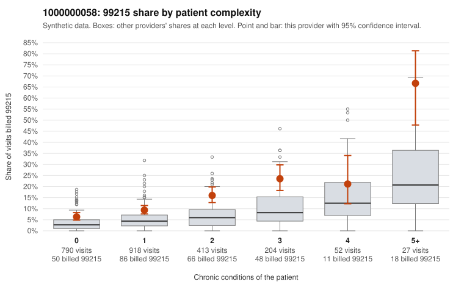

# 1000000058: 1000000058: too few returned records to judge

**Leaning (advisory):** Inconclusive

## Why

1000000058 billed 99215 on 11.6% of 2,404 claims against an expected 4.5% given patient complexity (risk-adjusted score 6.50; plain z-score vs peers 0.86). 49% of this provider's 99215 claims were on patients with 0 or 1 chronic conditions. Records came back for 30 claims. Of 3 documented 99215 claims, 0 (0%) were documented below the billed level, against 20% for the comparison providers. Note checks on 30 returned notes (share showing each sign): problems 37%, late 0%, unsigned 0%, data 0%. No audit trail was received. 1 of 22 notes claiming moderate-or-higher data reviewed had no lab or test line on the claim. The evidence does not support a call either way yet. Examples: C0024789: billed 99214; documented MDM level low, minutes not recorded. C0024495: billed 99215, patient aged 40 with 1 chronic condition(s) (hypothyroidism). C0024546: billed 99215, patient aged 31 with 0 chronic condition(s).

## Evidence chart

## Cited claims

`C0024789`, `C0024495`, `C0024546`

## Suggested next steps

- 30 charts came back but do not settle it: request a targeted sample of 99215 charts, starting with C0024789, C0024495, C0024546.
- Re-check after the targeted charts arrive; do not call upcoding or a sicker panel on this evidence alone.

---
Citations checked: 3/3 valid. Synthetic data. The leaning is advisory; the flag comes from the statistical screen, and no clinical documentation is available beyond the sampled records-review facts shown in the packet.
