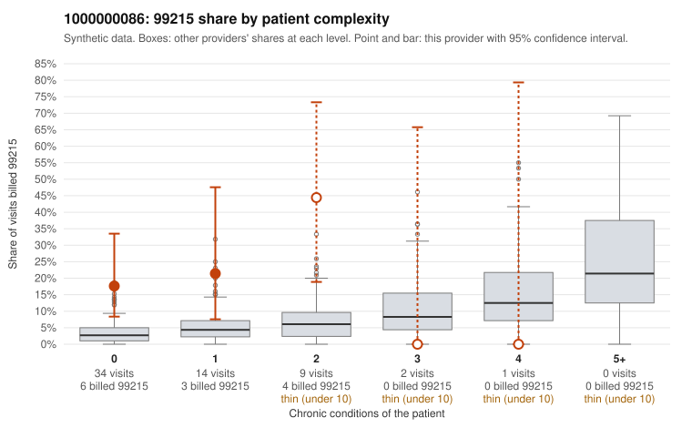

# 1000000086: 1000000086: too few returned records to judge

**Leaning (advisory):** Inconclusive

## Why

1000000086 billed 99215 on 21.7% of 60 claims against an expected 3.8% given patient complexity (risk-adjusted score 2.79; plain z-score vs peers 2.66). 69% of this provider's 99215 claims were on patients with 0 or 1 chronic conditions. Records came back for 29 claims. Of 3 documented 99215 claims, 0 (0%) were documented below the billed level, against 20% for the comparison providers. Note checks on 29 returned notes (share showing each sign): problems 48%, late 0%, unsigned 0%, data 3%. No audit trail was received. 1 of 20 notes claiming moderate-or-higher data reviewed had no lab or test line on the claim. The evidence does not support a call either way yet. Examples: C0042786: billed 99214; documented MDM level low, minutes not recorded. C0042808: billed 99214, patient aged 77 with 3 chronic condition(s) (obesity;heart failure;osteoarthritis); documented MDM level low, 24 minutes. C0042782: billed 99215, patient aged 47 with 1 chronic condition(s) (type 2 diabetes). C0042787: billed 99215, patient aged 47 with 1 chronic condition(s) (type 2 diabetes).

## Evidence chart

## Cited claims

`C0042786`, `C0042808`, `C0042782`, `C0042787`

## Suggested next steps

- 29 charts came back but do not settle it: request a targeted sample of 99215 charts, starting with C0042786, C0042808, C0042782.
- Re-check after the targeted charts arrive; do not call upcoding or a sicker panel on this evidence alone.

---
Citations checked: 4/4 valid. Synthetic data. The leaning is advisory; the flag comes from the statistical screen, and no clinical documentation is available beyond the sampled records-review facts shown in the packet.
