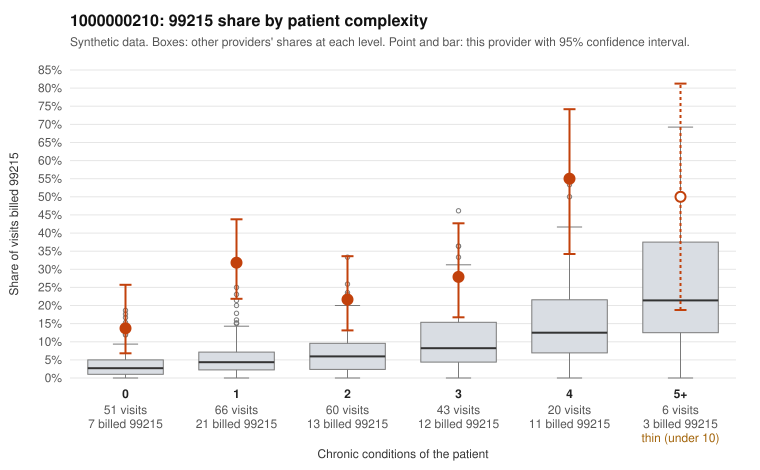

# 1000000210: 1000000210: 1 of 23 documented 99215 claims (4%) are documented below the billed level

**Leaning (advisory):** Pattern consistent with upcoding

## Why

1000000210 billed 99215 on 27.2% of 246 claims against an expected 5.8% given patient complexity (risk-adjusted score 5.57; plain z-score vs peers 3.66). 42% of this provider's 99215 claims were on patients with 0 or 1 chronic conditions. Records came back for 45 claims. Of 23 documented 99215 claims, 1 (4%) were documented below the billed level, against 20% for the comparison providers. Note checks on 45 returned notes (share showing each sign): problems 27%, late 16%, unsigned 0%, data 11%, bulk created 2%, paste heavy 7%. 8 of 38 notes claiming moderate-or-higher data reviewed had no lab or test line on the claim. This pattern is consistent with upcoding. It is a reason to review the records, not a finding. Examples: C0106546: billed 99215, patient aged 35 with 4 chronic condition(s) (type 2 diabetes;hyperlipidemia;hypertension;COPD); documented MDM level moderate, minutes not recorded. C0106389: billed 99215, patient aged 41 with 1 chronic condition(s) (hypertension). C0106395: billed 99215, patient aged 34 with 1 chronic condition(s) (depression). C0106397: billed 99215, patient aged 65 with 1 chronic condition(s) (COPD).

## Evidence chart

## Cited claims

`C0106546`, `C0106389`, `C0106395`, `C0106397`

## Suggested next steps

- Request the full charts for C0106546, C0106389, C0106395 and have a certified coder re-score each against the current E/M rules (medical decision making or total time).
- If the re-scoring confirms the pattern, review the random sample in the recovery packet's sampling plan before any overpayment estimate; do not extrapolate from a targeted sample.
- Look at the notes themselves: 27% address fewer problems than their level implies and 16% were signed late; request the audit trail for C0106546, C0106389, C0106395.

---
Citations checked: 4/4 valid. Synthetic data. The leaning is advisory; the flag comes from the statistical screen, and no clinical documentation is available beyond the sampled records-review facts shown in the packet.
