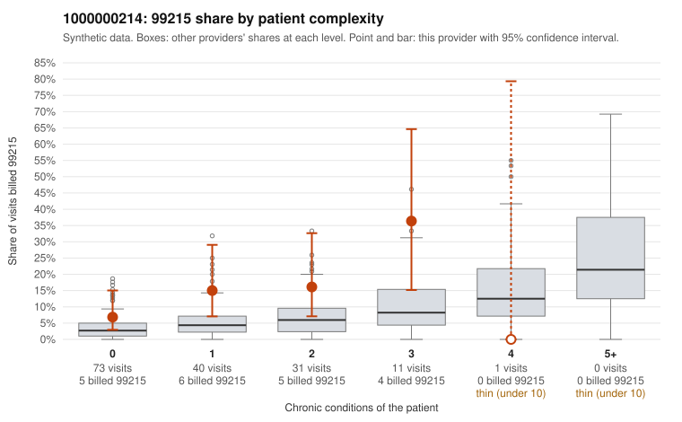

# 1000000214: 1000000214: too few returned records to judge

**Leaning (advisory):** Inconclusive

## Why

1000000214 billed 99215 on 12.8% of 156 claims against an expected 4.1% given patient complexity (risk-adjusted score 2.12; plain z-score vs peers 1.08). 55% of this provider's 99215 claims were on patients with 0 or 1 chronic conditions. Records came back for 29 claims. Of 3 documented 99215 claims, 0 (0%) were documented below the billed level, against 20% for the comparison providers. Note checks on 29 returned notes (share showing each sign): problems 41%, late 3%, unsigned 0%, data 7%. No audit trail was received. 3 of 21 notes claiming moderate-or-higher data reviewed had no lab or test line on the claim. The evidence does not support a call either way yet. Examples: C0107291: billed 99214; documented MDM level low, minutes not recorded. C0107257: billed 99215, patient aged 42 with 0 chronic condition(s). C0107269: billed 99215, patient aged 73 with 1 chronic condition(s) (asthma); documented MDM level high, 40 minutes.

## Evidence chart

## Cited claims

`C0107291`, `C0107257`, `C0107269`

## Suggested next steps

- 29 charts came back but do not settle it: request a targeted sample of 99215 charts, starting with C0107291, C0107257, C0107269.
- Re-check after the targeted charts arrive; do not call upcoding or a sicker panel on this evidence alone.

---
Citations checked: 3/3 valid. Synthetic data. The leaning is advisory; the flag comes from the statistical screen, and no clinical documentation is available beyond the sampled records-review facts shown in the packet.
