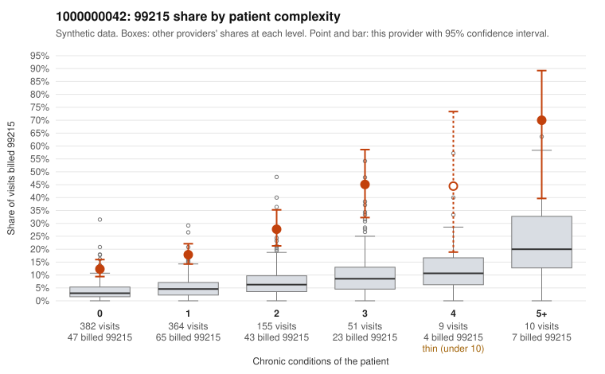

# 1000000042: 1000000042: too few returned records to judge

**Leaning (advisory):** Inconclusive

## Why

1000000042 billed 99215 on 19.5% of 971 claims against an expected 4.2% given patient complexity (risk-adjusted score 9.89; plain z-score vs peers 2.36). 59% of this provider's 99215 claims were on patients with 0 or 1 chronic conditions. Records came back for 45 claims. Of 22 documented 99215 claims, 3 (14%) were documented below the billed level, against 41% for the comparison providers. Note checks on 45 returned notes (share showing each sign): problems 42%, late 2%, unsigned 0%, data 9%. No audit trail was received. 7 of 35 notes claiming moderate-or-higher data reviewed had no lab or test line on the claim. The evidence does not support a call either way yet. Examples: C0026530: billed 99215; documented MDM level moderate, minutes not recorded. C0026714: billed 99215; documented MDM level moderate, 35 minutes. C0026405: billed 99215, patient aged 52 with 0 chronic condition(s). C0026445: billed 99215, patient aged 26 with 1 chronic condition(s) (type 2 diabetes).

## Evidence chart

## Cited claims

`C0026530`, `C0026714`, `C0026405`, `C0026445`

## Suggested next steps

- 45 charts came back but do not settle it: request a targeted sample of 99215 charts, starting with C0026530, C0026714, C0026405.
- Re-check after the targeted charts arrive; do not call upcoding or a sicker panel on this evidence alone.

---
Citations checked: 4/4 valid. Synthetic data. The leaning is advisory; the flag comes from the statistical screen, and no clinical documentation is available beyond the sampled records-review facts shown in the packet.
