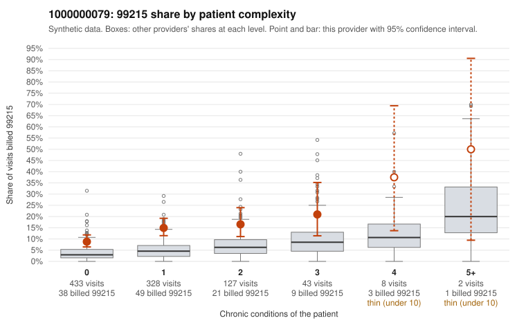

# 1000000079: 1000000079: 10 of 19 documented 99214 and 99215 claims (53%) are documented below the billed level

**Leaning (advisory):** Pattern consistent with upcoding

## Why

1000000079 billed 99215 on 12.9% of 941 claims against an expected 4.0% given patient complexity (risk-adjusted score 5.76; plain z-score vs peers 1.09). 72% of this provider's 99215 claims were on patients with 0 or 1 chronic conditions. Records came back for 30 claims. Of 5 documented 99215 claims, 4 (80%) were documented below the billed level, against 41% for the comparison providers. Note checks on 30 returned notes (share showing each sign): problems 33%, late 3%, unsigned 0%, data 0%. No audit trail was received. 1 of 16 notes claiming moderate-or-higher data reviewed had no lab or test line on the claim. This pattern is consistent with upcoding. It is a reason to review the records, not a finding. Examples: C0046498: billed 99215; documented MDM level moderate, minutes not recorded. C0046507: billed 99215; documented MDM level moderate, 31 minutes. C0046660: billed 99215, patient aged 54 with 1 chronic condition(s) (asthma); documented MDM level moderate, 31 minutes. C0046288: billed 99215, patient aged 43 with 0 chronic condition(s). C0046296: billed 99215, patient aged 43 with 1 chronic condition(s) (atrial fibrillation). C0046299: billed 99215, patient aged 78 with 1 chronic condition(s) (depression).

## Evidence chart

## Cited claims

`C0046498`, `C0046507`, `C0046660`, `C0046288`, `C0046296`, `C0046299`

## Suggested next steps

- Request the full charts for C0046498, C0046507, C0046660 and have a certified coder re-score each against the current E/M rules (medical decision making or total time).
- If the re-scoring confirms the pattern, review the random sample in the recovery packet's sampling plan before any overpayment estimate; do not extrapolate from a targeted sample.
- Look at the notes themselves: 33% address fewer problems than their level implies and 3% were signed late; request the audit trail for C0046498, C0046507, C0046660.

---
Citations checked: 6/6 valid. Synthetic data. The leaning is advisory; the flag comes from the statistical screen, and no clinical documentation is available beyond the sampled records-review facts shown in the packet.
