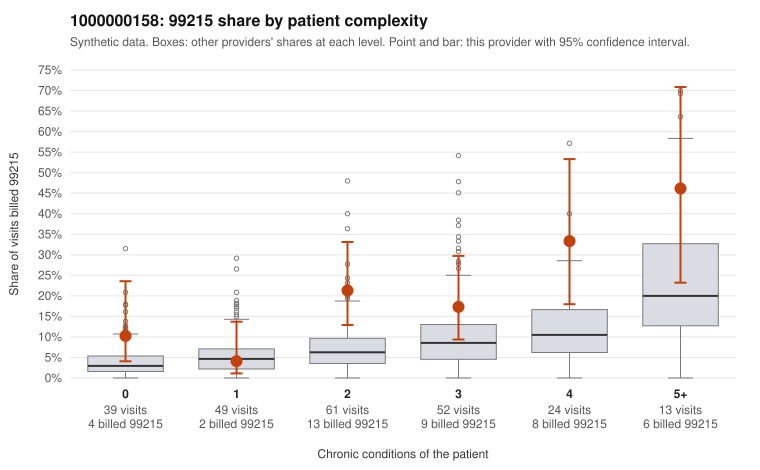

# 1000000158: 1000000158: too few returned records to judge

**Leaning (advisory):** Inconclusive

## Why

1000000158 billed 99215 on 17.6% of 238 claims against an expected 6.4% given patient complexity (risk-adjusted score 2.85; plain z-score vs peers 2.01). 14% of this provider's 99215 claims were on patients with 0 or 1 chronic conditions. Records came back for 30 claims. Of 4 documented 99215 claims, 2 (50%) were documented below the billed level, against 41% for the comparison providers. Note checks on 30 returned notes (share showing each sign): problems 27%, late 3%, unsigned 0%, data 17%, bulk created 0%, paste heavy 0%. 5 of 28 notes claiming moderate-or-higher data reviewed had no lab or test line on the claim. The evidence does not support a call either way yet. Examples: C0086372: billed 99215; documented MDM level moderate, minutes not recorded. C0086387: billed 99215; documented MDM level moderate, 37 minutes. C0086333: billed 99215, patient aged 53 with 0 chronic condition(s). C0086373: billed 99215, patient aged 38 with 0 chronic condition(s).

## Evidence chart

## Cited claims

`C0086372`, `C0086387`, `C0086333`, `C0086373`

## Suggested next steps

- 30 charts came back but do not settle it: request a targeted sample of 99215 charts, starting with C0086372, C0086387, C0086333.
- Re-check after the targeted charts arrive; do not call upcoding or a sicker panel on this evidence alone.

---
Citations checked: 4/4 valid. Synthetic data. The leaning is advisory; the flag comes from the statistical screen, and no clinical documentation is available beyond the sampled records-review facts shown in the packet.
