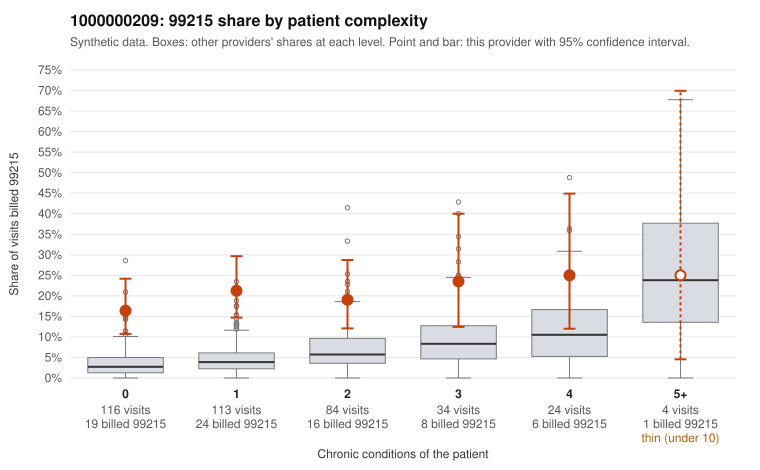

# 1000000209: 1000000209: 7 of 23 documented 99214 and 99215 claims (30%) are documented below the billed level

**Leaning (advisory):** Pattern consistent with upcoding

## Why

1000000209 billed 99215 on 19.7% of 375 claims against an expected 5.0% given patient complexity (risk-adjusted score 5.48; plain z-score vs peers 2.35). 58% of this provider's 99215 claims were on patients with 0 or 1 chronic conditions. Records came back for 30 claims. Of 4 documented 99215 claims, 4 (100%) were documented below the billed level, against 22% for the comparison providers. Note checks on 30 returned notes (share showing each sign): problems 27%, late 3%, unsigned 0%, data 7%. No audit trail was received. 3 of 19 notes claiming moderate-or-higher data reviewed had no lab or test line on the claim. This pattern is consistent with upcoding. It is a reason to review the records, not a finding. Examples: C0112016: billed 99215, patient aged 41 with 0 chronic condition(s); documented MDM level moderate, 32 minutes. C0112122: billed 99215, patient aged 80 with 1 chronic condition(s) (type 2 diabetes); documented MDM level moderate, 35 minutes. C0112230: billed 99215; documented MDM level moderate, minutes not recorded. C0111898: billed 99215, patient aged 63 with 0 chronic condition(s). C0111913: billed 99215, patient aged 43 with 0 chronic condition(s). C0111924: billed 99215, patient aged 50 with 0 chronic condition(s).

## Evidence chart

## Cited claims

`C0112016`, `C0112122`, `C0112230`, `C0111898`, `C0111913`, `C0111924`

## Suggested next steps

- Request the full charts for C0112016, C0112122, C0112230 and have a certified coder re-score each against the current E/M rules (medical decision making or total time).
- If the re-scoring confirms the pattern, review the random sample in the recovery packet's sampling plan before any overpayment estimate; do not extrapolate from a targeted sample.
- Look at the notes themselves: 27% address fewer problems than their level implies and 3% were signed late; request the audit trail for C0112016, C0112122, C0112230.

---
Citations checked: 6/6 valid. Synthetic data. The leaning is advisory; the flag comes from the statistical screen, and no clinical documentation is available beyond the sampled records-review facts shown in the packet.
