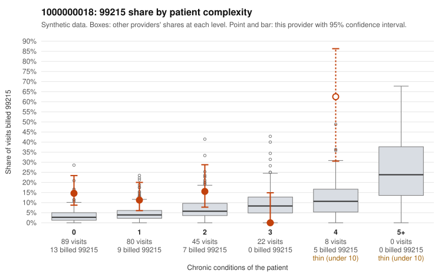

# Payment Integrity dossier: 1000000018

> Draft for human review. Statistical and records-sample evidence only; not a finding. Compliance or legal review is needed before any provider contact, notice or recoupment.

## Provider overview

| | |
|---|---|
| Specialty / state | Family Practice, GA (synthetic) |
| Claims / patients | 244 / 115 |
| Billed mix (99211 to 99215) | 1 / 2 / 50 / 157 / 34 |
| 99215 share | 13.9% |
| Expected 99215 share given patient complexity | 4.5% |
| Screen scores | z vs peers 1.29; risk-adjusted 3.00; flagged by eb_ratio_t |

## Case summary (advisory)

**1000000018: 6 of 25 documented 99214 and 99215 claims (24%) are documented below the billed level**

Leaning: pattern consistent with upcoding. Citations checked: 5/5 valid.

1000000018 billed 99215 on 13.9% of 244 claims against an expected 4.5% given patient complexity (risk-adjusted score 3.00; plain z-score vs peers 1.29). 65% of this provider's 99215 claims were on patients with 0 or 1 chronic conditions. Records came back for 30 claims. Of 4 documented 99215 claims, 2 (50%) were documented below the billed level, against 22% for the comparison providers. Note checks on 30 returned notes (share showing each sign): problems 30%, late 13%, unsigned 0%, data 13%, bulk created 0%, paste heavy 3%. 4 of 20 notes claiming moderate-or-higher data reviewed had no lab or test line on the claim. This pattern is consistent with upcoding. It is a reason to review the records, not a finding. Examples: C0004191: billed 99215, patient aged 23 with 0 chronic condition(s); documented MDM level moderate, 38 minutes. C0004215: billed 99215; documented MDM level moderate, 34 minutes. C0004025: billed 99215, patient aged 43 with 1 chronic condition(s) (hypertension). C0004030: billed 99215, patient aged 58 with 1 chronic condition(s) (chronic kidney disease); documented MDM level high, 45 minutes. C0004032: billed 99215, patient aged 49 with 0 chronic condition(s).

## Evidence chart

## Records-review sample so far

Documentation is on file for 30 claims (12% of this provider's claims).

| Billed | Documented | Documentation below billed level | Rate | All-provider rate |
|---|---|---|---|---|
| 99213 | 5 | 0 | 0.0% | 4.1% |
| 99214 | 21 | 4 | 19.0% | 5.0% |
| 99215 | 4 | 2 | 50.0% | 21.6% |

## Recommended next steps for Payment Integrity

1. Request records for the sampled claims in `record_request_list.csv` (23 claims across 99215).
2. Review the records against E/M documentation rules and record the supported level for each claim.
3. Run the overpayment estimator on the reviewed sample (`sampling_plan.md` explains how).
4. Notice, appeal rights, recoupment, education or corrective action, and any referral are decisions for the PI team, compliance and counsel. Nothing here drafts those.

Suggested follow-ups from the case summary:

- Request the full charts for C0004191, C0004215, C0004025 and have a certified coder re-score each against the current E/M rules (medical decision making or total time).
- If the re-scoring confirms the pattern, review the random sample in the recovery packet's sampling plan before any overpayment estimate; do not extrapolate from a targeted sample.
- Look at the notes themselves: 30% address fewer problems than their level implies and 13% were signed late; request the audit trail for C0004191, C0004215, C0004025.

## Limits

- Synthetic data; no real claims or providers.
- The leaning is advisory. The flag comes from the statistical screen; the summary explains it.
- The records-review sample is partial and was simulated for this project.
- Allowed amounts are GA Family Practice averages from a public CMS file, not this provider's actual payments.
