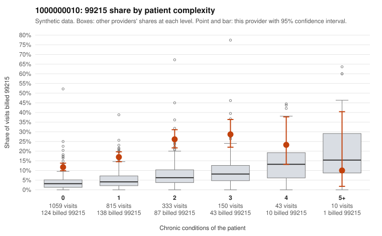

# 1000000010: 1000000010: 0 of 6 documented 99215 claims (0%) are documented below the billed level

**Leaning (advisory):** Pattern consistent with upcoding

## Why

1000000010 billed 99215 on 16.7% of 2,410 claims against an expected 4.1% given patient complexity (risk-adjusted score 12.35; plain z-score vs peers 1.44). 65% of this provider's 99215 claims were on patients with 0 or 1 chronic conditions. Records came back for 30 claims. Of 6 documented 99215 claims, 0 (0%) were documented below the billed level, against 31% for the comparison providers. Note checks on 30 returned notes (share showing each sign): problems 37%, late 20%, unsigned 0%, data 10%. No audit trail was received. 5 of 18 notes claiming moderate-or-higher data reviewed had no lab or test line on the claim. This pattern is consistent with upcoding. It is a reason to review the records, not a finding. Examples: C0006306: billed 99214; documented MDM level low, 25 minutes. C0006746: billed 99214; documented MDM level low, minutes not recorded. C0006278: billed 99215, patient aged 49 with 0 chronic condition(s). C0006354: billed 99215, patient aged 45 with 0 chronic condition(s). C0006471: billed 99215, patient aged 54 with 1 chronic condition(s) (depression).

## Evidence chart

## Cited claims

`C0006306`, `C0006746`, `C0006278`, `C0006354`, `C0006471`

## Suggested next steps

- Request the full charts for C0006306, C0006746, C0006278 and have a certified coder re-score each against the current E/M rules (medical decision making or total time).
- If the re-scoring confirms the pattern, review the random sample in the recovery packet's sampling plan before any overpayment estimate; do not extrapolate from a targeted sample.
- Look at the notes themselves: 37% address fewer problems than their level implies and 20% were signed late; request the audit trail for C0006306, C0006746, C0006278.

---
Citations checked: 5/5 valid. Synthetic data. The leaning is advisory; the flag comes from the statistical screen, and no clinical documentation is available beyond the sampled records-review facts shown in the packet.
