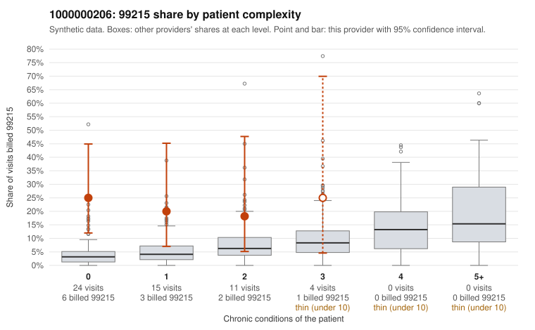

# 1000000206: Provider 1000000206 bills 99215 heavily on young, low-complexity patients, but the small documented sample does not show more unsupported 99215s than peers, so the evidence is mixed.

**Leaning (advisory):** Inconclusive

## Why

1000000206 billed 99215 on 22.2% of 54 claims against an expected 4.1% given patient complexity (risk-adjusted score 2.57; plain z-score vs peers 2.29). 75% of this provider's 99215 claims were on patients with 0 or 1 chronic conditions. Records came back for 20 claims. Of 6 documented 99215 claims, 2 (33%) were documented below the billed level, against 31% for the comparison providers. Note checks on 20 returned notes (share showing each sign): problems 35%, late 5%, unsigned 0%, data 5%. No audit trail was received. 4 of 15 notes claiming moderate-or-higher data reviewed had no lab or test line on the claim. The claims pattern leans toward upcoding: the elevated 99215 share holds in every complexity band, including patients with no chronic conditions, and none of the sampled 99215s are on high-complexity patients. Sampled 99215s include routine presentations in young adults, such as back pain (C0103685, C0103692), upper respiratory infection (C0103689, C0103708) and repeated hypertension visits for one 23-year-old (C0103687, C0103732, C0103737). The documentation does not confirm this, because the unsupported rate among documented 99215s is about the same as the all-provider rate. With only 6 documented 99215 claims, it is too thin to settle the question either way. Some notes recorded as supporting high MDM are surprising for the presentation (a rash in a 26-year-old with no conditions, C0103695, which is also flagged for problem-list issues), and some notes claim data reviewed with no matching lab or test line on the claim. Both are weak signs that notes may be inflated or cloned to match the billed level, not proof. A reviewer should first read the full notes for the supported 99215s (C0103687, C0103695, C0103732) against the visit reason, request the missing audit trail to check for cloning or bulk creation, and widen the records request so more 99215 and 99214 claims are documented. Examples: C0103685: billed 99215, patient aged 21 with 0 chronic condition(s); documented MDM level moderate, minutes not recorded. C0103708: billed 99215, patient aged 34 with 0 chronic condition(s); documented MDM level moderate, 26 minutes. C0103681: billed 99215, patient aged 66 with 0 chronic condition(s).

## Evidence chart

## Cited claims

`C0103685`, `C0103708`, `C0103681`

## Suggested next steps

- 20 charts came back but do not settle it: request a targeted sample of 99215 charts, starting with C0103685, C0103708, C0103681.
- Re-check after the targeted charts arrive; do not call upcoding or a sicker panel on this evidence alone.

---
Citations checked: 3/3 valid. Synthetic data. The leaning is advisory; the flag comes from the statistical screen, and no clinical documentation is available beyond the sampled records-review facts shown in the packet.
