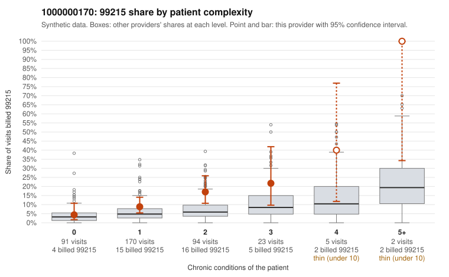

# 1000000170: 1000000170: too few returned records to judge

**Leaning (advisory):** Inconclusive

## Why

1000000170 billed 99215 on 11.4% of 385 claims against an expected 4.7% given patient complexity (risk-adjusted score 2.24; plain z-score vs peers 0.61). 43% of this provider's 99215 claims were on patients with 0 or 1 chronic conditions. Records came back for 30 claims. Of 3 documented 99215 claims, 0 (0%) were documented below the billed level, against 24% for the comparison providers. Note checks on 30 returned notes (share showing each sign): problems 23%, late 0%, unsigned 0%, data 0%. No audit trail was received. 1 of 18 notes claiming moderate-or-higher data reviewed had no lab or test line on the claim. The evidence does not support a call either way yet. Examples: C0089602: billed 99215, patient aged 54 with 0 chronic condition(s). C0089637: billed 99215, patient aged 68 with 0 chronic condition(s).

## Evidence chart

## Cited claims

`C0089602`, `C0089637`

## Suggested next steps

- 30 charts came back but do not settle it: request a targeted sample of 99215 charts, starting with C0089602, C0089637.
- Re-check after the targeted charts arrive; do not call upcoding or a sicker panel on this evidence alone.

---
Citations checked: 2/2 valid. Synthetic data. The leaning is advisory; the flag comes from the statistical screen, and no clinical documentation is available beyond the sampled records-review facts shown in the packet.
