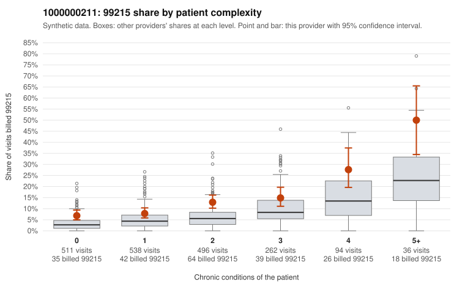

# 1000000211: 1000000211: too few returned records to judge

**Leaning (advisory):** Inconclusive

## Why

1000000211 billed 99215 on 11.6% of 1,937 claims against an expected 5.3% given patient complexity (risk-adjusted score 4.32; plain z-score vs peers 0.60). 34% of this provider's 99215 claims were on patients with 0 or 1 chronic conditions. Records came back for 30 claims. Of 3 documented 99215 claims, 0 (0%) were documented below the billed level, against 27% for the comparison providers. Note checks on 30 returned notes (share showing each sign): problems 20%, late 3%, unsigned 0%, data 3%. No audit trail was received. 2 of 23 notes claiming moderate-or-higher data reviewed had no lab or test line on the claim. The evidence does not support a call either way yet. Examples: C0118993: billed 99215, patient aged 49 with 1 chronic condition(s) (obesity). C0119001: billed 99215, patient aged 44 with 0 chronic condition(s).

## Evidence chart

## Cited claims

`C0118993`, `C0119001`

## Suggested next steps

- 30 charts came back but do not settle it: request a targeted sample of 99215 charts, starting with C0118993, C0119001.
- Re-check after the targeted charts arrive; do not call upcoding or a sicker panel on this evidence alone.

---
Citations checked: 2/2 valid. Synthetic data. The leaning is advisory; the flag comes from the statistical screen, and no clinical documentation is available beyond the sampled records-review facts shown in the packet.
