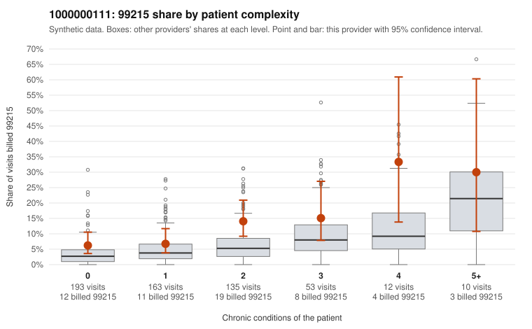

# 1000000111: 1000000111: too few returned records to judge

**Leaning (advisory):** Inconclusive

## Why

1000000111 billed 99215 on 10.1% of 566 claims against an expected 4.5% given patient complexity (risk-adjusted score 2.83; plain z-score vs peers 0.60). 40% of this provider's 99215 claims were on patients with 0 or 1 chronic conditions. Records came back for 30 claims. Of 2 documented 99215 claims, 2 (100%) were documented below the billed level, against 42% for the comparison providers. Note checks on 30 returned notes (share showing each sign): problems 33%, late 7%, unsigned 0%, data 0%. No audit trail was received. 0 of 17 notes claiming moderate-or-higher data reviewed had no lab or test line on the claim. The evidence does not support a call either way yet. Examples: C0050382: billed 99215; documented MDM level moderate, 37 minutes. C0050809: billed 99215, patient aged 44 with 0 chronic condition(s); documented MDM level moderate, 36 minutes. C0050298: billed 99215, patient aged 66 with 1 chronic condition(s) (depression). C0050317: billed 99215, patient aged 62 with 0 chronic condition(s).

## Evidence chart

## Cited claims

`C0050382`, `C0050809`, `C0050298`, `C0050317`

## Suggested next steps

- 30 charts came back but do not settle it: request a targeted sample of 99215 charts, starting with C0050382, C0050809, C0050298.
- Re-check after the targeted charts arrive; do not call upcoding or a sicker panel on this evidence alone.

---
Citations checked: 4/4 valid. Synthetic data. The leaning is advisory; the flag comes from the statistical screen, and no clinical documentation is available beyond the sampled records-review facts shown in the packet.
