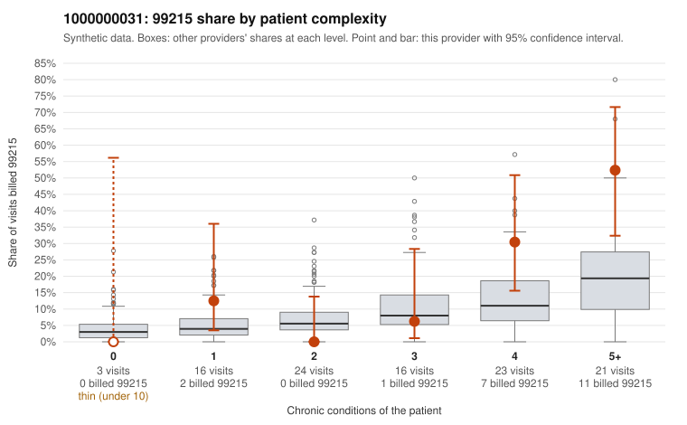

# 1000000031: 1000000031: too few returned records to judge

**Leaning (advisory):** Inconclusive

## Why

1000000031 billed 99215 on 20.4% of 103 claims against an expected 8.6% given patient complexity (risk-adjusted score 1.68; plain z-score vs peers 2.59). 10% of this provider's 99215 claims were on patients with 0 or 1 chronic conditions. Records came back for 24 claims. Of 3 documented 99215 claims, 0 (0%) were documented below the billed level, against 42% for the comparison providers. Note checks on 24 returned notes (share showing each sign): problems 8%, late 0%, unsigned 0%, data 4%. No audit trail was received. 4 of 18 notes claiming moderate-or-higher data reviewed had no lab or test line on the claim. The evidence does not support a call either way yet. Examples: C0010878: billed 99215, patient aged 59 with 1 chronic condition(s) (asthma). C0010936: billed 99215, patient aged 59 with 1 chronic condition(s) (asthma).

## Evidence chart

## Cited claims

`C0010878`, `C0010936`

## Suggested next steps

- 24 charts came back but do not settle it: request a targeted sample of 99215 charts, starting with C0010878, C0010936.
- Re-check after the targeted charts arrive; do not call upcoding or a sicker panel on this evidence alone.

---
Citations checked: 2/2 valid. Synthetic data. The leaning is advisory; the flag comes from the statistical screen, and no clinical documentation is available beyond the sampled records-review facts shown in the packet.
