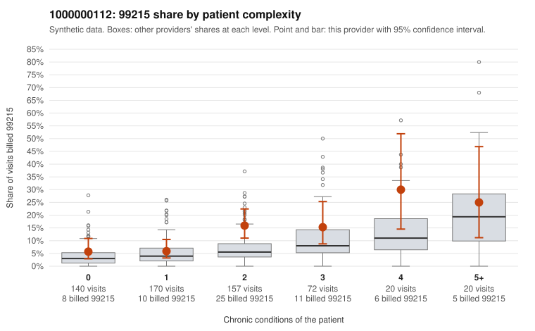

# 1000000112: 1000000112: too few returned records to judge

**Leaning (advisory):** Inconclusive

## Why

1000000112 billed 99215 on 11.2% of 579 claims against an expected 5.2% given patient complexity (risk-adjusted score 2.66; plain z-score vs peers 0.87). 28% of this provider's 99215 claims were on patients with 0 or 1 chronic conditions. Records came back for 30 claims. Of 1 documented 99215 claims, 0 (0%) were documented below the billed level, against 42% for the comparison providers. Note checks on 30 returned notes (share showing each sign): problems 13%, late 10%, unsigned 0%, data 0%. No audit trail was received. 0 of 17 notes claiming moderate-or-higher data reviewed had no lab or test line on the claim. The evidence does not support a call either way yet. Examples: C0056979: billed 99213; documented MDM level straightforward, minutes not recorded. C0057546: billed 99214; documented MDM level low, minutes not recorded. C0056933: billed 99215, patient aged 51 with 1 chronic condition(s) (hyperlipidemia). C0057060: billed 99215, patient aged 58 with 1 chronic condition(s) (type 2 diabetes).

## Evidence chart

## Cited claims

`C0056979`, `C0057546`, `C0056933`, `C0057060`

## Suggested next steps

- 30 charts came back but do not settle it: request a targeted sample of 99215 charts, starting with C0056979, C0057546, C0056933.
- Re-check after the targeted charts arrive; do not call upcoding or a sicker panel on this evidence alone.

---
Citations checked: 4/4 valid. Synthetic data. The leaning is advisory; the flag comes from the statistical screen, and no clinical documentation is available beyond the sampled records-review facts shown in the packet.
