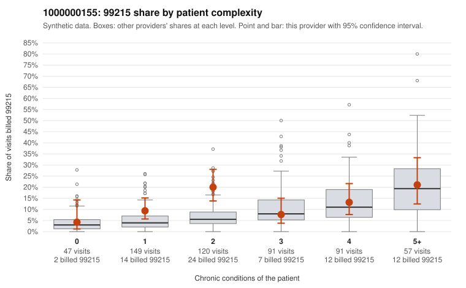

# 1000000155: 1000000155: too few returned records to judge

**Leaning (advisory):** Inconclusive

## Why

1000000155 billed 99215 on 12.8% of 555 claims against an expected 7.0% given patient complexity (risk-adjusted score 2.16; plain z-score vs peers 1.16). 23% of this provider's 99215 claims were on patients with 0 or 1 chronic conditions. Records came back for 28 claims. Of 2 documented 99215 claims, 0 (0%) were documented below the billed level, against 42% for the comparison providers. Note checks on 28 returned notes (share showing each sign): problems 14%, late 21%, unsigned 0%, data 18%, bulk created 11%, paste heavy 11%. 6 of 16 notes claiming moderate-or-higher data reviewed had no lab or test line on the claim. The evidence does not support a call either way yet. Examples: C0075077: billed 99215, patient aged 64 with 0 chronic condition(s). C0075107: billed 99215, patient aged 53 with 1 chronic condition(s) (hyperlipidemia).

## Evidence chart

## Cited claims

`C0075077`, `C0075107`

## Suggested next steps

- 28 charts came back but do not settle it: request a targeted sample of 99215 charts, starting with C0075077, C0075107.
- Re-check after the targeted charts arrive; do not call upcoding or a sicker panel on this evidence alone.

---
Citations checked: 2/2 valid. Synthetic data. The leaning is advisory; the flag comes from the statistical screen, and no clinical documentation is available beyond the sampled records-review facts shown in the packet.
