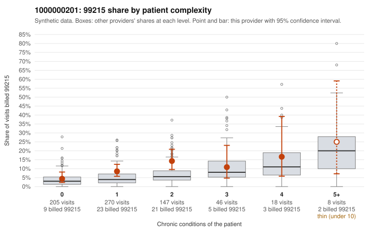

# 1000000201: 1000000201: too few returned records to judge

**Leaning (advisory):** Inconclusive

## Why

1000000201 billed 99215 on 9.1% of 694 claims against an expected 4.4% given patient complexity (risk-adjusted score 2.37; plain z-score vs peers 0.46). 51% of this provider's 99215 claims were on patients with 0 or 1 chronic conditions. Records came back for 24 claims. Of 2 documented 99215 claims, 0 (0%) were documented below the billed level, against 42% for the comparison providers. Note checks on 24 returned notes (share showing each sign): problems 38%, late 0%, unsigned 0%, data 8%. No audit trail was received. 5 of 16 notes claiming moderate-or-higher data reviewed had no lab or test line on the claim. The evidence does not support a call either way yet. Examples: C0099491: billed 99214; documented MDM level low, 24 minutes. C0100026: billed 99214; documented MDM level low, 27 minutes. C0099347: billed 99215, patient aged 46 with 1 chronic condition(s) (COPD). C0099349: billed 99215, patient aged 67 with 0 chronic condition(s).

## Evidence chart

## Cited claims

`C0099491`, `C0100026`, `C0099347`, `C0099349`

## Suggested next steps

- 24 charts came back but do not settle it: request a targeted sample of 99215 charts, starting with C0099491, C0100026, C0099347.
- Re-check after the targeted charts arrive; do not call upcoding or a sicker panel on this evidence alone.

---
Citations checked: 4/4 valid. Synthetic data. The leaning is advisory; the flag comes from the statistical screen, and no clinical documentation is available beyond the sampled records-review facts shown in the packet.
