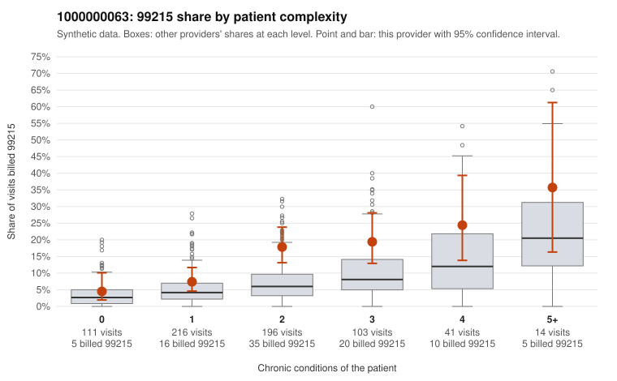

# 1000000063: 1000000063: too few returned records to judge

**Leaning (advisory):** Inconclusive

## Why

1000000063 billed 99215 on 13.4% of 681 claims against an expected 5.5% given patient complexity (risk-adjusted score 3.13; plain z-score vs peers 1.07). 23% of this provider's 99215 claims were on patients with 0 or 1 chronic conditions. Records came back for 30 claims. Of 4 documented 99215 claims, 1 (25%) were documented below the billed level, against 40% for the comparison providers. Note checks on 30 returned notes (share showing each sign): problems 20%, late 7%, unsigned 0%, data 7%. No audit trail was received. 3 of 16 notes claiming moderate-or-higher data reviewed had no lab or test line on the claim. The evidence does not support a call either way yet. Examples: C0032917: billed 99215; documented MDM level moderate, minutes not recorded. C0032747: billed 99215, patient aged 73 with 0 chronic condition(s). C0032750: billed 99215, patient aged 45 with 1 chronic condition(s) (hyperlipidemia).

## Evidence chart

## Cited claims

`C0032917`, `C0032747`, `C0032750`

## Suggested next steps

- 30 charts came back but do not settle it: request a targeted sample of 99215 charts, starting with C0032917, C0032747, C0032750.
- Re-check after the targeted charts arrive; do not call upcoding or a sicker panel on this evidence alone.

---
Citations checked: 3/3 valid. Synthetic data. The leaning is advisory; the flag comes from the statistical screen, and no clinical documentation is available beyond the sampled records-review facts shown in the packet.
