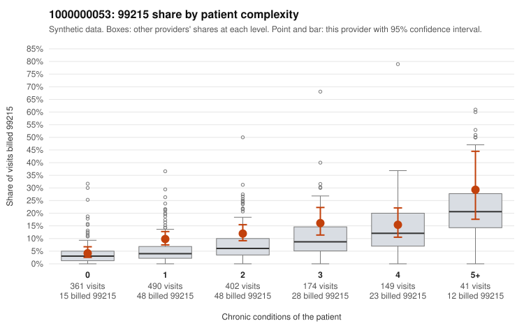

# 1000000053: 1000000053: too few returned records to judge

**Leaning (advisory):** Inconclusive

## Why

1000000053 billed 99215 on 10.8% of 1,617 claims against an expected 5.5% given patient complexity (risk-adjusted score 3.50; plain z-score vs peers 0.54). 36% of this provider's 99215 claims were on patients with 0 or 1 chronic conditions. Records came back for 30 claims. Of 5 documented 99215 claims, 0 (0%) were documented below the billed level, against 21% for the comparison providers. Note checks on 30 returned notes (share showing each sign): problems 7%, late 3%, unsigned 0%, data 7%. No audit trail was received. 2 of 18 notes claiming moderate-or-higher data reviewed had no lab or test line on the claim. The evidence does not support a call either way yet. Examples: C0027287: billed 99213; documented MDM level straightforward, minutes not recorded. C0027318: billed 99214; documented MDM level low, minutes not recorded. C0026369: billed 99215, patient aged 63 with 0 chronic condition(s). C0026400: billed 99215, patient aged 71 with 1 chronic condition(s) (asthma).

## Evidence chart

## Cited claims

`C0027287`, `C0027318`, `C0026369`, `C0026400`

## Suggested next steps

- 30 charts came back but do not settle it: request a targeted sample of 99215 charts, starting with C0027287, C0027318, C0026369.
- Re-check after the targeted charts arrive; do not call upcoding or a sicker panel on this evidence alone.

---
Citations checked: 4/4 valid. Synthetic data. The leaning is advisory; the flag comes from the statistical screen, and no clinical documentation is available beyond the sampled records-review facts shown in the packet.
