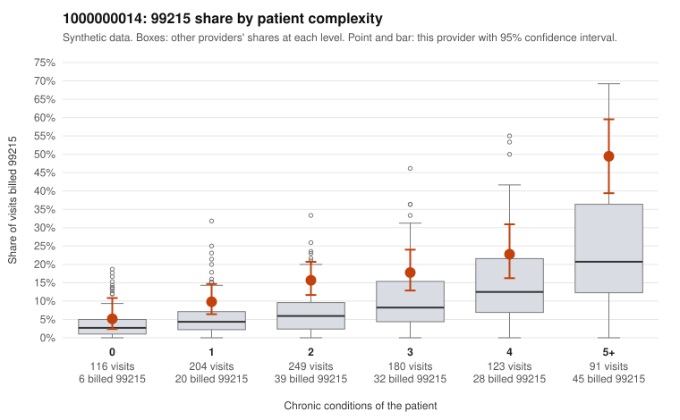

# 1000000014: 1000000014: too few returned records to judge

**Leaning (advisory):** Inconclusive

## Why

1000000014 billed 99215 on 17.7% of 963 claims against an expected 7.4% given patient complexity (risk-adjusted score 4.71; plain z-score vs peers 1.95). 15% of this provider's 99215 claims were on patients with 0 or 1 chronic conditions. Records came back for 29 claims. Of 4 documented 99215 claims, 1 (25%) were documented below the billed level, against 20% for the comparison providers. Note checks on 29 returned notes (share showing each sign): problems 10%, late 7%, unsigned 0%, data 3%. No audit trail was received. 3 of 22 notes claiming moderate-or-higher data reviewed had no lab or test line on the claim. The evidence does not support a call either way yet. Examples: C0004811: billed 99215; documented MDM level moderate, minutes not recorded. C0004523: billed 99215, patient aged 56 with 1 chronic condition(s) (hypothyroidism). C0004538: billed 99215, patient aged 34 with 0 chronic condition(s).

## Evidence chart

## Cited claims

`C0004811`, `C0004523`, `C0004538`

## Suggested next steps

- 29 charts came back but do not settle it: request a targeted sample of 99215 charts, starting with C0004811, C0004523, C0004538.
- Re-check after the targeted charts arrive; do not call upcoding or a sicker panel on this evidence alone.

---
Citations checked: 3/3 valid. Synthetic data. The leaning is advisory; the flag comes from the statistical screen, and no clinical documentation is available beyond the sampled records-review facts shown in the packet.
