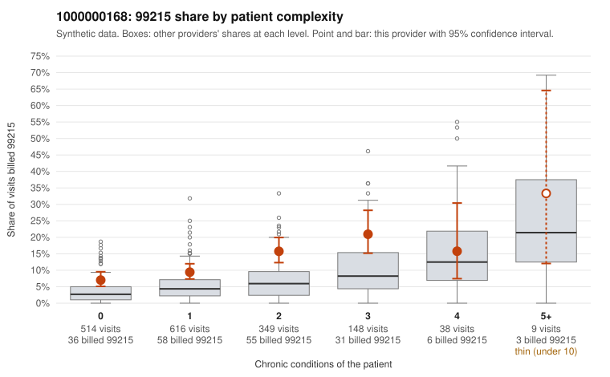

# 1000000168: 1000000168: too few returned records to judge

**Leaning (advisory):** Inconclusive

## Why

1000000168 billed 99215 on 11.3% of 1,674 claims against an expected 4.5% given patient complexity (risk-adjusted score 5.13; plain z-score vs peers 0.81). 50% of this provider's 99215 claims were on patients with 0 or 1 chronic conditions. Records came back for 29 claims. Of 3 documented 99215 claims, 2 (67%) were documented below the billed level, against 20% for the comparison providers. Note checks on 29 returned notes (share showing each sign): problems 24%, late 0%, unsigned 0%, data 3%. No audit trail was received. 2 of 17 notes claiming moderate-or-higher data reviewed had no lab or test line on the claim. The evidence does not support a call either way yet. Examples: C0084565: billed 99215; documented MDM level moderate, minutes not recorded. C0086041: billed 99215; documented MDM level moderate, minutes not recorded. C0084515: billed 99215, patient aged 32 with 0 chronic condition(s). C0084547: billed 99215, patient aged 45 with 0 chronic condition(s).

## Evidence chart

## Cited claims

`C0084565`, `C0086041`, `C0084515`, `C0084547`

## Suggested next steps

- 29 charts came back but do not settle it: request a targeted sample of 99215 charts, starting with C0084565, C0086041, C0084515.
- Re-check after the targeted charts arrive; do not call upcoding or a sicker panel on this evidence alone.

---
Citations checked: 4/4 valid. Synthetic data. The leaning is advisory; the flag comes from the statistical screen, and no clinical documentation is available beyond the sampled records-review facts shown in the packet.
