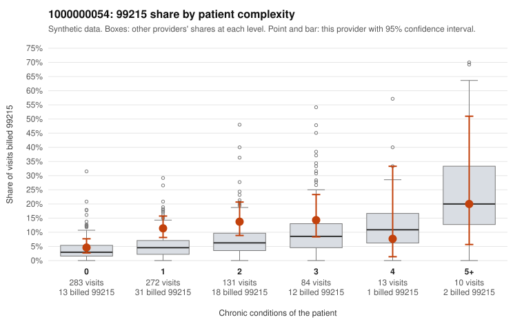

# 1000000054: 1000000054: too few returned records to judge

**Leaning (advisory):** Inconclusive

## Why

1000000054 billed 99215 on 9.7% of 793 claims against an expected 4.5% given patient complexity (risk-adjusted score 2.79; plain z-score vs peers 0.49). 57% of this provider's 99215 claims were on patients with 0 or 1 chronic conditions. Records came back for 30 claims. Of 3 documented 99215 claims, 2 (67%) were documented below the billed level, against 41% for the comparison providers. Note checks on 30 returned notes (share showing each sign): problems 27%, late 7%, unsigned 0%, data 7%. No audit trail was received. 2 of 8 notes claiming moderate-or-higher data reviewed had no lab or test line on the claim. The evidence does not support a call either way yet. Examples: C0035912: billed 99215, patient aged 55 with 1 chronic condition(s) (hypertension); documented MDM level moderate, minutes not recorded. C0036182: billed 99215; documented MDM level moderate, minutes not recorded. C0035560: billed 99215, patient aged 35 with 0 chronic condition(s). C0035589: billed 99215, patient aged 56 with 0 chronic condition(s).

## Evidence chart

## Cited claims

`C0035912`, `C0036182`, `C0035560`, `C0035589`

## Suggested next steps

- 30 charts came back but do not settle it: request a targeted sample of 99215 charts, starting with C0035912, C0036182, C0035560.
- Re-check after the targeted charts arrive; do not call upcoding or a sicker panel on this evidence alone.

---
Citations checked: 4/4 valid. Synthetic data. The leaning is advisory; the flag comes from the statistical screen, and no clinical documentation is available beyond the sampled records-review facts shown in the packet.
