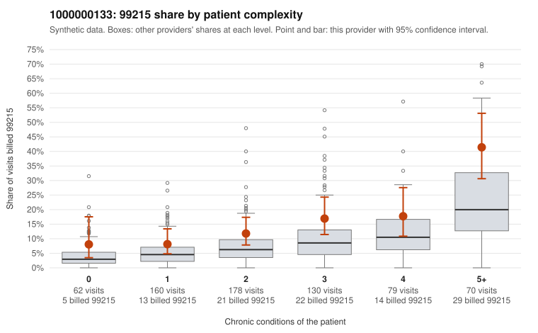

# 1000000133: 1000000133: too few returned records to judge

**Leaning (advisory):** Inconclusive

## Why

1000000133 billed 99215 on 15.3% of 679 claims against an expected 7.1% given patient complexity (risk-adjusted score 3.35; plain z-score vs peers 1.56). 17% of this provider's 99215 claims were on patients with 0 or 1 chronic conditions. Records came back for 30 claims. Of 6 documented 99215 claims, 2 (33%) were documented below the billed level, against 41% for the comparison providers. Note checks on 30 returned notes (share showing each sign): problems 13%, late 7%, unsigned 0%, data 3%. No audit trail was received. 5 of 25 notes claiming moderate-or-higher data reviewed had no lab or test line on the claim. The evidence does not support a call either way yet. Examples: C0073543: billed 99215, patient aged 50 with 0 chronic condition(s); documented MDM level moderate, minutes not recorded. C0073608: billed 99215; documented MDM level moderate, 37 minutes. C0073431: billed 99215, patient aged 43 with 1 chronic condition(s) (hypertension). C0073468: billed 99215, patient aged 32 with 0 chronic condition(s).

## Evidence chart

## Cited claims

`C0073543`, `C0073608`, `C0073431`, `C0073468`

## Suggested next steps

- 30 charts came back but do not settle it: request a targeted sample of 99215 charts, starting with C0073543, C0073608, C0073431.
- Re-check after the targeted charts arrive; do not call upcoding or a sicker panel on this evidence alone.

---
Citations checked: 4/4 valid. Synthetic data. The leaning is advisory; the flag comes from the statistical screen, and no clinical documentation is available beyond the sampled records-review facts shown in the packet.
