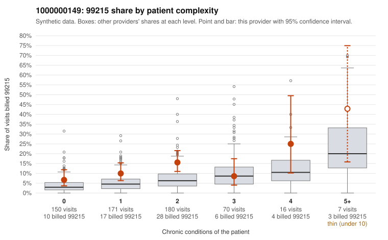

# 1000000149: 1000000149: too few returned records to judge

**Leaning (advisory):** Inconclusive

## Why

1000000149 billed 99215 on 11.4% of 594 claims against an expected 5.0% given patient complexity (risk-adjusted score 2.90; plain z-score vs peers 0.82). 40% of this provider's 99215 claims were on patients with 0 or 1 chronic conditions. Records came back for 30 claims. Of 1 documented 99215 claims, 1 (100%) were documented below the billed level, against 41% for the comparison providers. Note checks on 30 returned notes (share showing each sign): problems 23%, late 3%, unsigned 0%, data 0%. No audit trail was received. 1 of 15 notes claiming moderate-or-higher data reviewed had no lab or test line on the claim. The evidence does not support a call either way yet. Examples: C0082872: billed 99215; documented MDM level moderate, minutes not recorded. C0082378: billed 99215, patient aged 79 with 1 chronic condition(s) (heart failure). C0082403: billed 99215, patient aged 34 with 0 chronic condition(s).

## Evidence chart

## Cited claims

`C0082872`, `C0082378`, `C0082403`

## Suggested next steps

- 30 charts came back but do not settle it: request a targeted sample of 99215 charts, starting with C0082872, C0082378, C0082403.
- Re-check after the targeted charts arrive; do not call upcoding or a sicker panel on this evidence alone.

---
Citations checked: 3/3 valid. Synthetic data. The leaning is advisory; the flag comes from the statistical screen, and no clinical documentation is available beyond the sampled records-review facts shown in the packet.
