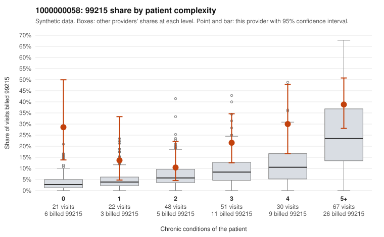

# 1000000058: 1000000058: documented 99215 claims mostly support the level billed (0% below)

**Leaning (advisory):** Pattern consistent with a high-acuity panel

## Why

1000000058 billed 99215 on 25.1% of 239 claims against an expected 11.4% given patient complexity (risk-adjusted score 2.85; plain z-score vs peers 3.34). 15% of this provider's 99215 claims were on patients with 0 or 1 chronic conditions. Records came back for 30 claims. Of 8 documented 99215 claims, 0 (0%) were documented below the billed level, against 22% for the comparison providers. Note checks on 30 returned notes (share showing each sign): problems 3%, late 13%, unsigned 0%, data 10%. No audit trail was received. 3 of 23 notes claiming moderate-or-higher data reviewed had no lab or test line on the claim. This pattern is consistent with a high-acuity panel. The sampled documentation supports the billed level. Examples: C0023818: billed 99215; documented MDM level high, 39 minutes. C0023827: billed 99215; documented MDM level high, 48 minutes. C0023841: billed 99215; documented MDM level high, 44 minutes. C0023858: billed 99215, patient aged 72 with 5 chronic condition(s) (type 2 diabetes;obesity;hyperlipidemia;hypertension;atrial fibrillation). C0023867: billed 99215, patient aged 71 with 4 chronic condition(s) (hyperlipidemia;hypertension;osteoarthritis;chronic kidney disease).

## Evidence chart

## Cited claims

`C0023818`, `C0023827`, `C0023841`, `C0023858`, `C0023867`

## Suggested next steps

- Do not pursue recovery on this evidence: 30 charts came back and they support the level billed (0 of 8 documented 99215 claims below the billed level).
- Revisit if the 99215 share keeps rising against peers or a larger sample shows unsupported claims.

---
Citations checked: 5/5 valid. Synthetic data. The leaning is advisory; the flag comes from the statistical screen, and no clinical documentation is available beyond the sampled records-review facts shown in the packet.
