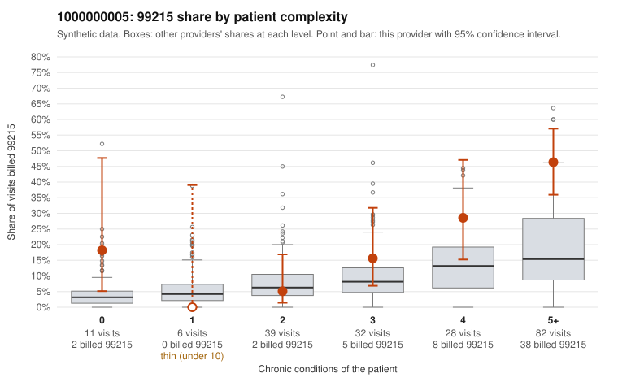

# 1000000005: 1000000005: documented 99215 claims mostly support the level billed (0% below)

**Leaning (advisory):** Pattern consistent with a high-acuity panel

## Why

1000000005 billed 99215 on 27.8% of 198 claims against an expected 12.0% given patient complexity (risk-adjusted score 2.67; plain z-score vs peers 3.14). 4% of this provider's 99215 claims were on patients with 0 or 1 chronic conditions. Records came back for 30 claims. Of 7 documented 99215 claims, 0 (0%) were documented below the billed level, against 31% for the comparison providers. Note checks on 30 returned notes (share showing each sign): problems 7%, late 7%, unsigned 0%, data 3%. No audit trail was received. 1 of 23 notes claiming moderate-or-higher data reviewed had no lab or test line on the claim. This pattern is consistent with a high-acuity panel. The sampled documentation supports the billed level. Examples: C0002670: billed 99215; documented MDM level high, 51 minutes. C0002793: billed 99215, patient aged 48 with 5 chronic condition(s) (type 2 diabetes;depression;heart failure;COPD;asthma); documented MDM level high, 30 minutes. C0002839: billed 99215; documented MDM level high, minutes not recorded. C0002659: billed 99215, patient aged 91 with 4 chronic condition(s) (hypothyroidism;type 2 diabetes;hyperlipidemia;osteoarthritis). C0002668: billed 99215, patient aged 96 with 5 chronic condition(s) (type 2 diabetes;obesity;hyperlipidemia;atrial fibrillation;osteoarthritis).

## Evidence chart

## Cited claims

`C0002670`, `C0002793`, `C0002839`, `C0002659`, `C0002668`

## Suggested next steps

- Do not pursue recovery on this evidence: 30 charts came back and they support the level billed (0 of 7 documented 99215 claims below the billed level).
- Revisit if the 99215 share keeps rising against peers or a larger sample shows unsupported claims.

---
Citations checked: 5/5 valid. Synthetic data. The leaning is advisory; the flag comes from the statistical screen, and no clinical documentation is available beyond the sampled records-review facts shown in the packet.
