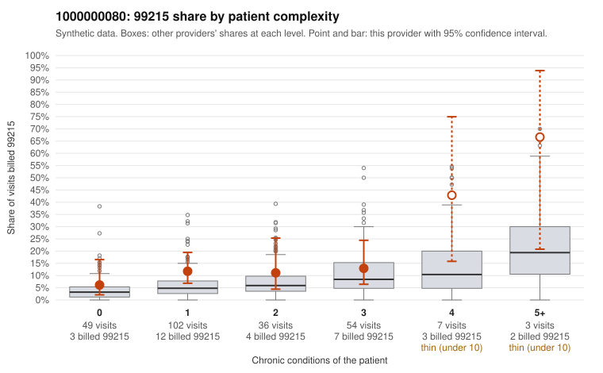

# 1000000080: Provider 1000000080 bills 99215 well above expectation, often on low-complexity patients, but every documented 99215 supports the billed level, while note-integrity signals suggest the documentation itself may be templated or inflated.

**Leaning (advisory):** Inconclusive

## Why

1000000080 billed 99215 on 12.4% of 251 claims against an expected 5.4% given patient complexity (risk-adjusted score 1.71; plain z-score vs peers 0.75). 48% of this provider's 99215 claims were on patients with 0 or 1 chronic conditions. Records came back for 45 claims. Of 20 documented 99215 claims, 0 (0%) were documented below the billed level, against 24% for the comparison providers. Note checks on 45 returned notes (share showing each sign): problems 40%, late 27%, unsigned 0%, data 16%, bulk created 4%, paste heavy 7%. 10 of 36 notes claiming moderate-or-higher data reviewed had no lab or test line on the claim. The elevated 99215 share and the concentration of those visits on patients with 0–1 chronic conditions fit an upcoding pattern, though the modest plain z-score and the higher shares among the few 4+ condition visits (e.g., C0042957, C0043018, C0043211) suggest part of the excess reflects genuinely complex patients. On its face, the documentation points the other way: none of the 20 documented 99215 claims fell below the billed level, against roughly a quarter for peers, which would normally favor a legitimately complex panel. That support is weakened by the note signals. Nearly half of returned notes carry the duplicate flag, many are late, and several notes claim moderate-or-higher data review with no lab or test on the claim. Some 'supported' 99215s are on single-condition patients, such as C0043104 (obesity, also a data-flag example) and C0043154 (osteoarthritis, age 33), with high MDM and similar 43–48 minute times, which is consistent with cloned or inflated notes rather than proof of them. A reviewer should first read the full notes and audit trails for the low-complexity 99215s (C0043104, C0043154, C0043083, C0043130), compare them for templated text and repeated times, and request more charts, since only about 18% of claims were documented. Examples: C0042988: billed 99215, patient aged 74 with 1 chronic condition(s) (type 2 diabetes). C0043006: billed 99215, patient aged 33 with 1 chronic condition(s) (COPD).

## Evidence chart

## Cited claims

`C0042988`, `C0043006`

## Suggested next steps

- 45 charts came back but do not settle it: request a targeted sample of 99215 charts, starting with C0042988, C0043006.
- Re-check after the targeted charts arrive; do not call upcoding or a sicker panel on this evidence alone.

---
Citations checked: 2/2 valid. Synthetic data. The leaning is advisory; the flag comes from the statistical screen, and no clinical documentation is available beyond the sampled records-review facts shown in the packet.
