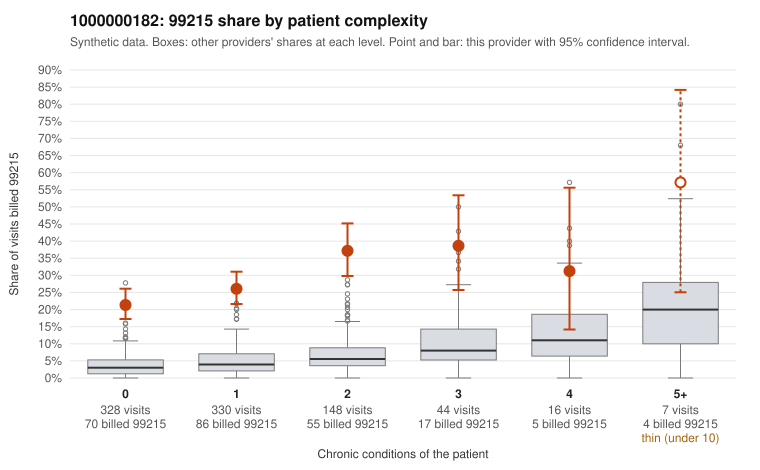

# 1000000182: Provider 1000000182's elevated 99215 billing is concentrated on low-complexity patients and is paired with frequent under-documentation at both 99214 and 99215, a pattern consistent with upcoding.

**Leaning (advisory):** Pattern consistent with upcoding

## Why

1000000182 billed 99215 on 27.1% of 873 claims against an expected 4.2% given patient complexity (risk-adjusted score 14.20; plain z-score vs peers 3.87). 66% of this provider's 99215 claims were on patients with 0 or 1 chronic conditions. Records came back for 30 claims. Of 8 documented 99215 claims, 5 (62%) were documented below the billed level, against 42% for the comparison providers. Note checks on 30 returned notes (share showing each sign): problems 50%, late 0%, unsigned 0%, data 10%, bulk created 0%, paste heavy 3%. 4 of 13 notes claiming moderate-or-higher data reviewed had no lab or test line on the claim. The excess 99215 share holds in every complexity stratum, including patients with zero or one condition, so panel acuity does not explain it. Sampled low-complexity 99215s are mostly simple encounters (J06.9, Z09, M54.50, a single I10 or E78.5); C0089578, an upper respiratory visit billed 99215, came back documented at only moderate MDM. Documentation is thin, with 30 charts and only 8 at 99215, and the 99215 unsupported rate is only modestly above peers. The stronger signal is at 99214, where 7 of 16 documented claims fell below the billed level against roughly 5% for peers, and about a third of notes were flagged as duplicates. Supported high-complexity visits such as C0089782 show some legitimately complex care, and the data-reviewed mismatch is weak evidence on its own. A reviewer should first request more charts for low-complexity 99215 and 99214 claims and check the duplicate or cloned notes against the audit trail. Examples: C0088974: billed 99215; documented MDM level moderate, 22 minutes. C0089218: billed 99215; documented MDM level moderate, 31 minutes. C0089543: billed 99215; documented MDM level moderate, minutes not recorded. C0088965: billed 99215, patient aged 20 with 0 chronic condition(s). C0088986: billed 99215, patient aged 70 with 1 chronic condition(s) (depression). C0089057: billed 99215, patient aged 38 with 0 chronic condition(s).

## Evidence chart

## Cited claims

`C0088974`, `C0089218`, `C0089543`, `C0088965`, `C0088986`, `C0089057`

## Suggested next steps

- Request the full charts for C0088974, C0089218, C0089543 and have a certified coder re-score each against the current E/M rules (medical decision making or total time).
- If the re-scoring confirms the pattern, review the random sample in the recovery packet's sampling plan before any overpayment estimate; do not extrapolate from a targeted sample.
- Look at the notes themselves: 50% address fewer problems than their level implies and 0% were signed late; request the audit trail for C0088974, C0089218, C0089543.

---
Citations checked: 6/6 valid. Synthetic data. The leaning is advisory; the flag comes from the statistical screen, and no clinical documentation is available beyond the sampled records-review facts shown in the packet.
