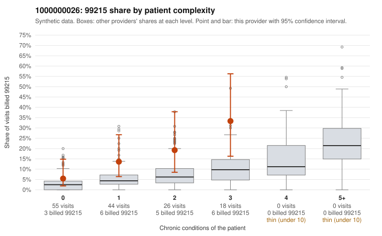

# 1000000026: 1000000026: too few returned records to judge

**Leaning (advisory):** Inconclusive

## Why

1000000026 billed 99215 on 14.0% of 143 claims against an expected 4.3% given patient complexity (risk-adjusted score 1.99; plain z-score vs peers 1.31). 45% of this provider's 99215 claims were on patients with 0 or 1 chronic conditions. Records came back for 30 claims. Of 6 documented 99215 claims, 1 (17%) were documented below the billed level, against 48% for the comparison providers. Note checks on 30 returned notes (share showing each sign): problems 30%, late 10%, unsigned 0%, data 10%, bulk created 0%, paste heavy 0%. 3 of 20 notes claiming moderate-or-higher data reviewed had no lab or test line on the claim. The evidence does not support a call either way yet. Examples: C0009108: billed 99215; documented MDM level moderate, minutes not recorded. C0009100: billed 99215, patient aged 26 with 0 chronic condition(s). C0009110: billed 99215, patient aged 36 with 1 chronic condition(s) (asthma).

## Evidence chart

## Cited claims

`C0009108`, `C0009100`, `C0009110`

## Suggested next steps

- 30 charts came back but do not settle it: request a targeted sample of 99215 charts, starting with C0009108, C0009100, C0009110.
- Re-check after the targeted charts arrive; do not call upcoding or a sicker panel on this evidence alone.

---
Citations checked: 3/3 valid. Synthetic data. The leaning is advisory; the flag comes from the statistical screen, and no clinical documentation is available beyond the sampled records-review facts shown in the packet.
