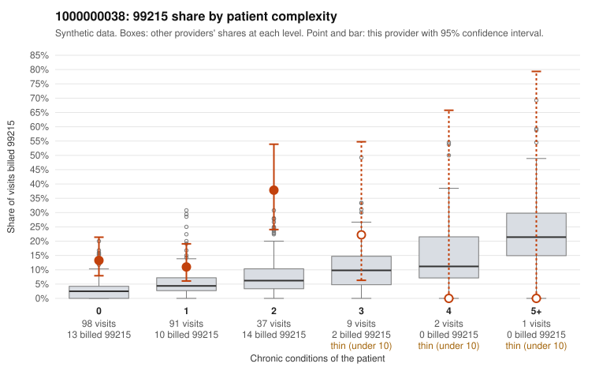

# 1000000038: 1000000038: 16 of 19 documented 99215 claims (84%) are documented below the billed level

**Leaning (advisory):** Pattern consistent with upcoding

## Why

1000000038 billed 99215 on 16.4% of 238 claims against an expected 4.0% given patient complexity (risk-adjusted score 3.52; plain z-score vs peers 1.76). 59% of this provider's 99215 claims were on patients with 0 or 1 chronic conditions. Records came back for 43 claims. Of 19 documented 99215 claims, 16 (84%) were documented below the billed level, against 48% for the comparison providers. Note checks on 43 returned notes (share showing each sign): problems 23%, late 0%, unsigned 0%, data 5%. No audit trail was received. 2 of 24 notes claiming moderate-or-higher data reviewed had no lab or test line on the claim. This pattern is consistent with upcoding. It is a reason to review the records, not a finding. Examples: C0013864: billed 99215; documented MDM level moderate, 31 minutes. C0013946: billed 99215; documented MDM level moderate, minutes not recorded. C0014034: billed 99215, patient aged 46 with 0 chronic condition(s); documented MDM level moderate, 30 minutes. C0013819: billed 99215, patient aged 55 with 0 chronic condition(s). C0013855: billed 99215, patient aged 54 with 1 chronic condition(s) (hyperlipidemia); documented MDM level high, minutes not recorded. C0013887: billed 99215, patient aged 73 with 0 chronic condition(s).

## Evidence chart

## Cited claims

`C0013864`, `C0013946`, `C0014034`, `C0013819`, `C0013855`, `C0013887`

## Suggested next steps

- Request the full charts for C0013864, C0013946, C0014034 and have a certified coder re-score each against the current E/M rules (medical decision making or total time).
- If the re-scoring confirms the pattern, review the random sample in the recovery packet's sampling plan before any overpayment estimate; do not extrapolate from a targeted sample.
- Look at the notes themselves: 23% address fewer problems than their level implies and 0% were signed late; request the audit trail for C0013864, C0013946, C0014034.

---
Citations checked: 6/6 valid. Synthetic data. The leaning is advisory; the flag comes from the statistical screen, and no clinical documentation is available beyond the sampled records-review facts shown in the packet.
