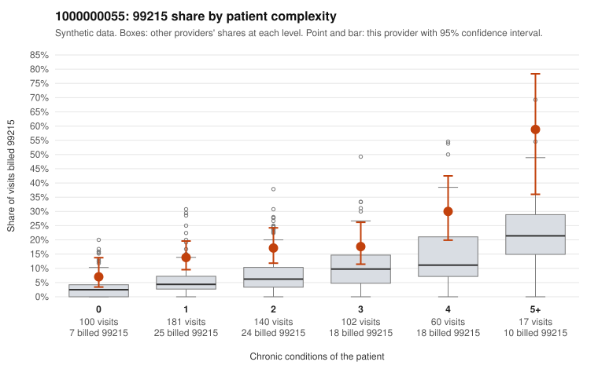

# 1000000055: 1000000055: too few returned records to judge

**Leaning (advisory):** Inconclusive

## Why

1000000055 billed 99215 on 17.0% of 600 claims against an expected 6.0% given patient complexity (risk-adjusted score 4.12; plain z-score vs peers 1.87). 31% of this provider's 99215 claims were on patients with 0 or 1 chronic conditions. Records came back for 30 claims. Of 5 documented 99215 claims, 0 (0%) were documented below the billed level, against 48% for the comparison providers. Note checks on 30 returned notes (share showing each sign): problems 37%, late 3%, unsigned 0%, data 3%. No audit trail was received. 1 of 19 notes claiming moderate-or-higher data reviewed had no lab or test line on the claim. The evidence does not support a call either way yet. Examples: C0022612: billed 99213; documented MDM level straightforward, minutes not recorded. C0022620: billed 99213; documented MDM level straightforward, minutes not recorded. C0022318: billed 99215, patient aged 55 with 0 chronic condition(s). C0022338: billed 99215, patient aged 55 with 1 chronic condition(s) (osteoarthritis).

## Evidence chart

## Cited claims

`C0022612`, `C0022620`, `C0022318`, `C0022338`

## Suggested next steps

- 30 charts came back but do not settle it: request a targeted sample of 99215 charts, starting with C0022612, C0022620, C0022318.
- Re-check after the targeted charts arrive; do not call upcoding or a sicker panel on this evidence alone.

---
Citations checked: 4/4 valid. Synthetic data. The leaning is advisory; the flag comes from the statistical screen, and no clinical documentation is available beyond the sampled records-review facts shown in the packet.
