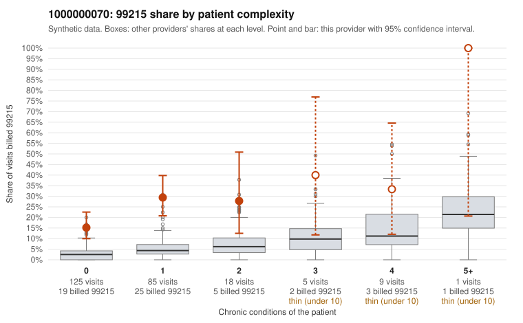

# 1000000070: 1000000070: 0 of 7 documented 99215 claims (0%) are documented below the billed level

**Leaning (advisory):** Pattern consistent with upcoding

## Why

1000000070 billed 99215 on 22.6% of 243 claims against an expected 3.8% given patient complexity (risk-adjusted score 5.56; plain z-score vs peers 2.92). 80% of this provider's 99215 claims were on patients with 0 or 1 chronic conditions. Records came back for 28 claims. Of 7 documented 99215 claims, 0 (0%) were documented below the billed level, against 48% for the comparison providers. Note checks on 28 returned notes (share showing each sign): problems 43%, late 14%, unsigned 0%, data 4%. No audit trail was received. 2 of 18 notes claiming moderate-or-higher data reviewed had no lab or test line on the claim. This pattern is consistent with upcoding. It is a reason to review the records, not a finding. Examples: C0031407: billed 99215, patient aged 62 with 0 chronic condition(s). C0031409: billed 99215, patient aged 42 with 1 chronic condition(s) (COPD); documented MDM level high, minutes not recorded. C0031414: billed 99215, patient aged 23 with 1 chronic condition(s) (obesity).

## Evidence chart

## Cited claims

`C0031407`, `C0031409`, `C0031414`

## Suggested next steps

- Request the full charts for C0031407, C0031409, C0031414 and have a certified coder re-score each against the current E/M rules (medical decision making or total time).
- If the re-scoring confirms the pattern, review the random sample in the recovery packet's sampling plan before any overpayment estimate; do not extrapolate from a targeted sample.
- Look at the notes themselves: 43% address fewer problems than their level implies and 14% were signed late; request the audit trail for C0031407, C0031409, C0031414.

---
Citations checked: 3/3 valid. Synthetic data. The leaning is advisory; the flag comes from the statistical screen, and no clinical documentation is available beyond the sampled records-review facts shown in the packet.
