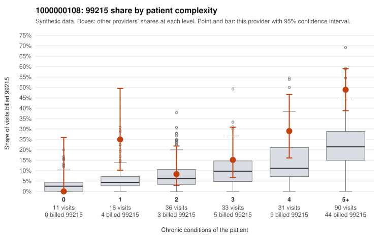

# 1000000108: 1000000108: documented 99215 claims mostly support the level billed (8% below)

**Leaning (advisory):** Pattern consistent with a high-acuity panel

## Why

1000000108 billed 99215 on 30.0% of 217 claims against an expected 11.9% given patient complexity (risk-adjusted score 2.96; plain z-score vs peers 4.28). 6% of this provider's 99215 claims were on patients with 0 or 1 chronic conditions. Records came back for 30 claims. Of 12 documented 99215 claims, 1 (8%) were documented below the billed level, against 48% for the comparison providers. Note checks on 30 returned notes (share showing each sign): problems 0%, late 7%, unsigned 0%, data 7%. No audit trail was received. 2 of 22 notes claiming moderate-or-higher data reviewed had no lab or test line on the claim. This pattern is consistent with a high-acuity panel. The sampled documentation supports the billed level. Examples: C0045880: billed 99215; documented MDM level high, 30 minutes. C0045906: billed 99215, patient aged 54 with 1 chronic condition(s) (asthma); documented MDM level high, 49 minutes. C0045952: billed 99215; documented MDM level high, 33 minutes. C0045816: billed 99215, patient aged 74 with 4 chronic condition(s) (depression;hypertension;atrial fibrillation;osteoarthritis). C0045826: billed 99215, patient aged 87 with 4 chronic condition(s) (type 2 diabetes;obesity;hypertension;osteoarthritis).

## Evidence chart

## Cited claims

`C0045880`, `C0045906`, `C0045952`, `C0045816`, `C0045826`

## Suggested next steps

- Do not pursue recovery on this evidence: 30 charts came back and they support the level billed (1 of 12 documented 99215 claims below the billed level).
- Revisit if the 99215 share keeps rising against peers or a larger sample shows unsupported claims.

---
Citations checked: 5/5 valid. Synthetic data. The leaning is advisory; the flag comes from the statistical screen, and no clinical documentation is available beyond the sampled records-review facts shown in the packet.
