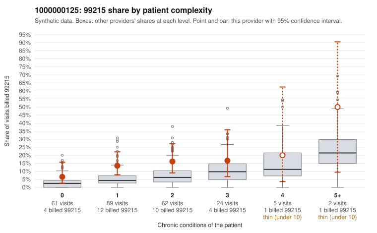

# 1000000125: 1000000125: too few returned records to judge

**Leaning (advisory):** Inconclusive

## Why

1000000125 billed 99215 on 13.2% of 243 claims against an expected 4.7% given patient complexity (risk-adjusted score 2.17; plain z-score vs peers 1.16). 50% of this provider's 99215 claims were on patients with 0 or 1 chronic conditions. Records came back for 30 claims. Of 2 documented 99215 claims, 0 (0%) were documented below the billed level, against 48% for the comparison providers. Note checks on 30 returned notes (share showing each sign): problems 27%, late 3%, unsigned 0%, data 0%. No audit trail was received. 1 of 23 notes claiming moderate-or-higher data reviewed had no lab or test line on the claim. The evidence does not support a call either way yet. Examples: C0052737: billed 99214; documented MDM level low, 29 minutes. C0052692: billed 99215, patient aged 40 with 1 chronic condition(s) (type 2 diabetes). C0052712: billed 99215, patient aged 28 with 0 chronic condition(s).

## Evidence chart

## Cited claims

`C0052737`, `C0052692`, `C0052712`

## Suggested next steps

- 30 charts came back but do not settle it: request a targeted sample of 99215 charts, starting with C0052737, C0052692, C0052712.
- Re-check after the targeted charts arrive; do not call upcoding or a sicker panel on this evidence alone.

---
Citations checked: 3/3 valid. Synthetic data. The leaning is advisory; the flag comes from the statistical screen, and no clinical documentation is available beyond the sampled records-review facts shown in the packet.
