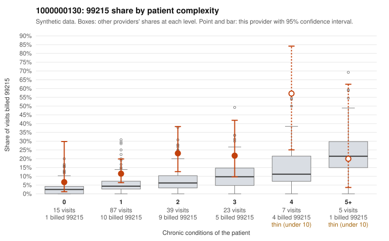

# 1000000130: 1000000130: too few returned records to judge

**Leaning (advisory):** Inconclusive

## Why

1000000130 billed 99215 on 17.0% of 176 claims against an expected 5.5% given patient complexity (risk-adjusted score 2.39; plain z-score vs peers 1.88). 37% of this provider's 99215 claims were on patients with 0 or 1 chronic conditions. Records came back for 30 claims. Of 4 documented 99215 claims, 1 (25%) were documented below the billed level, against 48% for the comparison providers. Note checks on 30 returned notes (share showing each sign): problems 27%, late 3%, unsigned 0%, data 0%. No audit trail was received. 0 of 19 notes claiming moderate-or-higher data reviewed had no lab or test line on the claim. The evidence does not support a call either way yet. Examples: C0055825: billed 99215, patient aged 50 with 0 chronic condition(s); documented MDM level moderate, minutes not recorded. C0055672: billed 99215, patient aged 39 with 1 chronic condition(s) (type 2 diabetes). C0055681: billed 99215, patient aged 42 with 1 chronic condition(s) (asthma).

## Evidence chart

## Cited claims

`C0055825`, `C0055672`, `C0055681`

## Suggested next steps

- 30 charts came back but do not settle it: request a targeted sample of 99215 charts, starting with C0055825, C0055672, C0055681.
- Re-check after the targeted charts arrive; do not call upcoding or a sicker panel on this evidence alone.

---
Citations checked: 3/3 valid. Synthetic data. The leaning is advisory; the flag comes from the statistical screen, and no clinical documentation is available beyond the sampled records-review facts shown in the packet.
