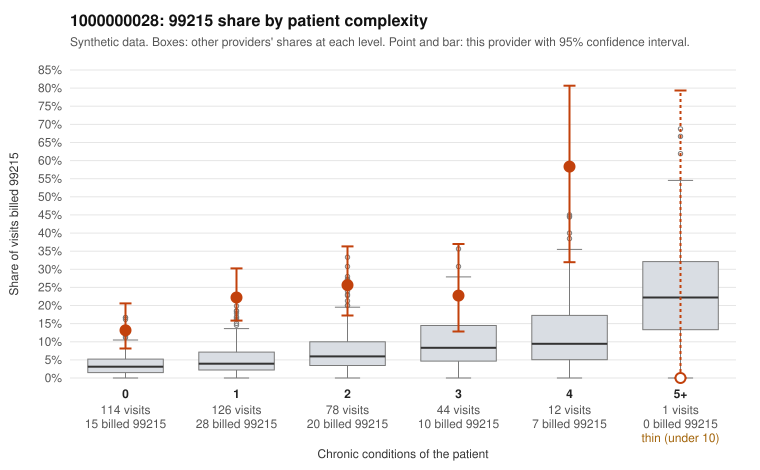

# 1000000028: 1000000028: too few returned records to judge

**Leaning (advisory):** Inconclusive

## Why

1000000028 billed 99215 on 21.3% of 375 claims against an expected 4.4% given patient complexity (risk-adjusted score 6.16; plain z-score vs peers 3.11). 54% of this provider's 99215 claims were on patients with 0 or 1 chronic conditions. Records came back for 44 claims. Of 17 documented 99215 claims, 9 (53%) were documented below the billed level, against 50% for the comparison providers. Note checks on 44 returned notes (share showing each sign): problems 34%, late 4%, unsigned 0%, data 0%. No audit trail was received. 1 of 32 notes claiming moderate-or-higher data reviewed had no lab or test line on the claim. The evidence does not support a call either way yet. Examples: C0018539: billed 99215, patient aged 55 with 4 chronic condition(s) (hyperlipidemia;hypertension;COPD;osteoarthritis); documented MDM level moderate, 37 minutes. C0018582: billed 99215; documented MDM level moderate, 33 minutes. C0018476: billed 99215, patient aged 39 with 1 chronic condition(s) (chronic kidney disease). C0018503: billed 99215, patient aged 27 with 0 chronic condition(s).

## Evidence chart

## Cited claims

`C0018539`, `C0018582`, `C0018476`, `C0018503`

## Suggested next steps

- 44 charts came back but do not settle it: request a targeted sample of 99215 charts, starting with C0018539, C0018582, C0018476.
- Re-check after the targeted charts arrive; do not call upcoding or a sicker panel on this evidence alone.

---
Citations checked: 4/4 valid. Synthetic data. The leaning is advisory; the flag comes from the statistical screen, and no clinical documentation is available beyond the sampled records-review facts shown in the packet.
