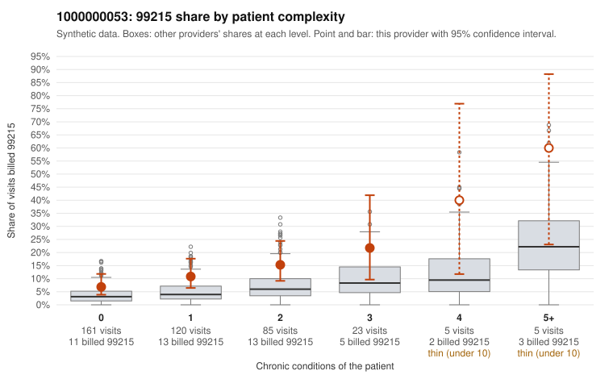

# 1000000053: 1000000053: too few returned records to judge

**Leaning (advisory):** Inconclusive

## Why

1000000053 billed 99215 on 11.8% of 399 claims against an expected 4.1% given patient complexity (risk-adjusted score 2.91; plain z-score vs peers 1.07). 51% of this provider's 99215 claims were on patients with 0 or 1 chronic conditions. Records came back for 30 claims. Of 2 documented 99215 claims, 0 (0%) were documented below the billed level, against 50% for the comparison providers. Note checks on 30 returned notes (share showing each sign): problems 40%, late 0%, unsigned 0%, data 3%. No audit trail was received. 4 of 17 notes claiming moderate-or-higher data reviewed had no lab or test line on the claim. The evidence does not support a call either way yet. Examples: C0032573: billed 99214; documented MDM level low, minutes not recorded. C0032485: billed 99215, patient aged 67 with 1 chronic condition(s) (obesity). C0032503: billed 99215, patient aged 60 with 0 chronic condition(s); documented MDM level high, minutes not recorded.

## Evidence chart

## Cited claims

`C0032573`, `C0032485`, `C0032503`

## Suggested next steps

- 30 charts came back but do not settle it: request a targeted sample of 99215 charts, starting with C0032573, C0032485, C0032503.
- Re-check after the targeted charts arrive; do not call upcoding or a sicker panel on this evidence alone.

---
Citations checked: 3/3 valid. Synthetic data. The leaning is advisory; the flag comes from the statistical screen, and no clinical documentation is available beyond the sampled records-review facts shown in the packet.
