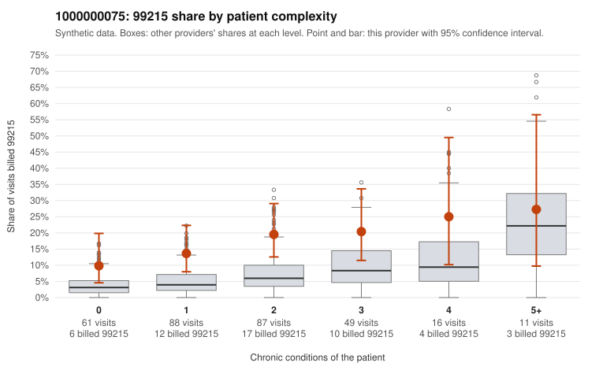

# 1000000075: 1000000075: too few returned records to judge

**Leaning (advisory):** Inconclusive

## Why

1000000075 billed 99215 on 16.7% of 312 claims against an expected 5.4% given patient complexity (risk-adjusted score 3.39; plain z-score vs peers 2.11). 35% of this provider's 99215 claims were on patients with 0 or 1 chronic conditions. Records came back for 30 claims. Of 8 documented 99215 claims, 0 (0%) were documented below the billed level, against 50% for the comparison providers. Note checks on 30 returned notes (share showing each sign): problems 20%, late 10%, unsigned 0%, data 7%. No audit trail was received. 4 of 22 notes claiming moderate-or-higher data reviewed had no lab or test line on the claim. The evidence does not support a call either way yet. Examples: C0041657: billed 99214; documented MDM level low, 25 minutes. C0041646: billed 99215, patient aged 46 with 1 chronic condition(s) (osteoarthritis). C0041659: billed 99215, patient aged 28 with 1 chronic condition(s) (hyperlipidemia); documented MDM level high, minutes not recorded.

## Evidence chart

## Cited claims

`C0041657`, `C0041646`, `C0041659`

## Suggested next steps

- 30 charts came back but do not settle it: request a targeted sample of 99215 charts, starting with C0041657, C0041646, C0041659.
- Re-check after the targeted charts arrive; do not call upcoding or a sicker panel on this evidence alone.

---
Citations checked: 3/3 valid. Synthetic data. The leaning is advisory; the flag comes from the statistical screen, and no clinical documentation is available beyond the sampled records-review facts shown in the packet.
