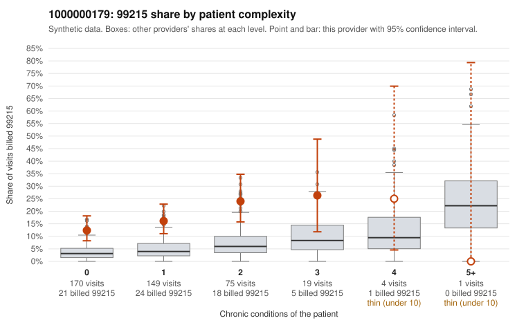

# 1000000179: 1000000179: too few returned records to judge

**Leaning (advisory):** Inconclusive

## Why

1000000179 billed 99215 on 16.5% of 418 claims against an expected 3.9% given patient complexity (risk-adjusted score 5.14; plain z-score vs peers 2.08). 65% of this provider's 99215 claims were on patients with 0 or 1 chronic conditions. Records came back for 29 claims. Of 9 documented 99215 claims, 1 (11%) were documented below the billed level, against 50% for the comparison providers. Note checks on 29 returned notes (share showing each sign): problems 38%, late 10%, unsigned 0%, data 7%. No audit trail was received. 2 of 23 notes claiming moderate-or-higher data reviewed had no lab or test line on the claim. The evidence does not support a call either way yet. Examples: C0101550: billed 99215; documented MDM level low, minutes not recorded. C0101336: billed 99215, patient aged 34 with 0 chronic condition(s); documented MDM level high, 48 minutes. C0101351: billed 99215, patient aged 62 with 0 chronic condition(s).

## Evidence chart

## Cited claims

`C0101550`, `C0101336`, `C0101351`

## Suggested next steps

- 29 charts came back but do not settle it: request a targeted sample of 99215 charts, starting with C0101550, C0101336, C0101351.
- Re-check after the targeted charts arrive; do not call upcoding or a sicker panel on this evidence alone.

---
Citations checked: 3/3 valid. Synthetic data. The leaning is advisory; the flag comes from the statistical screen, and no clinical documentation is available beyond the sampled records-review facts shown in the packet.
