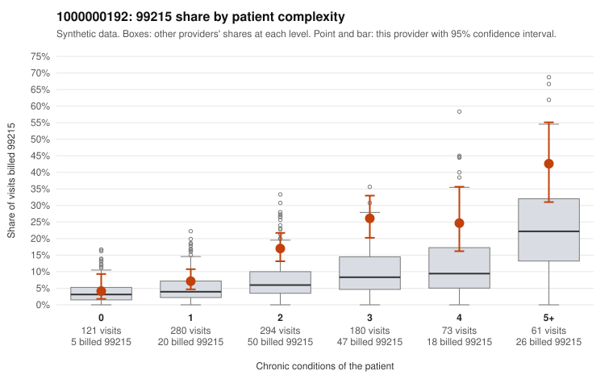

# 1000000192: 1000000192: documented 99215 claims mostly support the level billed (0% below)

**Leaning (advisory):** Pattern consistent with a high-acuity panel

## Why

1000000192 billed 99215 on 16.5% of 1,009 claims against an expected 6.0% given patient complexity (risk-adjusted score 5.42; plain z-score vs peers 2.06). 15% of this provider's 99215 claims were on patients with 0 or 1 chronic conditions. Records came back for 29 claims. Of 6 documented 99215 claims, 0 (0%) were documented below the billed level, against 50% for the comparison providers. Note checks on 29 returned notes (share showing each sign): problems 3%, late 3%, unsigned 0%, data 7%. No audit trail was received. 2 of 22 notes claiming moderate-or-higher data reviewed had no lab or test line on the claim. This pattern is consistent with a high-acuity panel. The sampled documentation supports the billed level. Examples: C0104770: billed 99215, patient aged 62 with 4 chronic condition(s) (hypothyroidism;type 2 diabetes;atrial fibrillation;COPD); documented MDM level high, 30 minutes. C0104919: billed 99215; documented MDM level high, minutes not recorded. C0105075: billed 99215, patient aged 64 with 1 chronic condition(s) (osteoarthritis); documented MDM level high, minutes not recorded. C0104696: billed 99215, patient aged 68 with 5 chronic condition(s) (hyperlipidemia;depression;hypertension;heart failure;osteoarthritis).

## Evidence chart

## Cited claims

`C0104770`, `C0104919`, `C0105075`, `C0104696`

## Suggested next steps

- Do not pursue recovery on this evidence: 29 charts came back and they support the level billed (0 of 6 documented 99215 claims below the billed level).
- Revisit if the 99215 share keeps rising against peers or a larger sample shows unsupported claims.

---
Citations checked: 4/4 valid. Synthetic data. The leaning is advisory; the flag comes from the statistical screen, and no clinical documentation is available beyond the sampled records-review facts shown in the packet.
