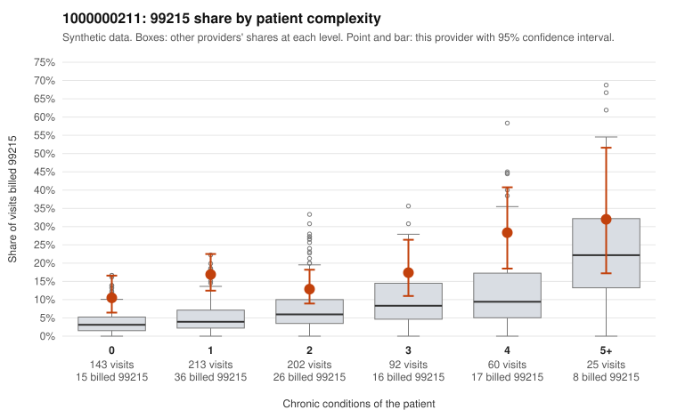

# 1000000211: 1000000211: documented 99215 claims mostly support the level billed (14% below)

**Leaning (advisory):** Pattern consistent with a high-acuity panel

## Why

1000000211 billed 99215 on 16.1% of 735 claims against an expected 5.4% given patient complexity (risk-adjusted score 4.97; plain z-score vs peers 1.98). 43% of this provider's 99215 claims were on patients with 0 or 1 chronic conditions. Records came back for 30 claims. Of 7 documented 99215 claims, 1 (14%) were documented below the billed level, against 50% for the comparison providers. Note checks on 30 returned notes (share showing each sign): problems 20%, late 3%, unsigned 0%, data 0%. No audit trail was received. 1 of 22 notes claiming moderate-or-higher data reviewed had no lab or test line on the claim. This pattern is consistent with a high-acuity panel. The sampled documentation supports the billed level. Examples: C0119321: billed 99215; documented MDM level high, 49 minutes. C0119406: billed 99215; documented MDM level high, 44 minutes. C0119498: billed 99215; documented MDM level high, 50 minutes. C0119447: billed 99215, patient aged 83 with 5 chronic condition(s) (type 2 diabetes;obesity;hypertension;atrial fibrillation;osteoarthritis). C0119478: billed 99215, patient aged 76 with 4 chronic condition(s) (type 2 diabetes;hyperlipidemia;heart failure;chronic kidney disease).

## Evidence chart

## Cited claims

`C0119321`, `C0119406`, `C0119498`, `C0119447`, `C0119478`

## Suggested next steps

- Do not pursue recovery on this evidence: 30 charts came back and they support the level billed (1 of 7 documented 99215 claims below the billed level).
- Revisit if the 99215 share keeps rising against peers or a larger sample shows unsupported claims.

---
Citations checked: 5/5 valid. Synthetic data. The leaning is advisory; the flag comes from the statistical screen, and no clinical documentation is available beyond the sampled records-review facts shown in the packet.
