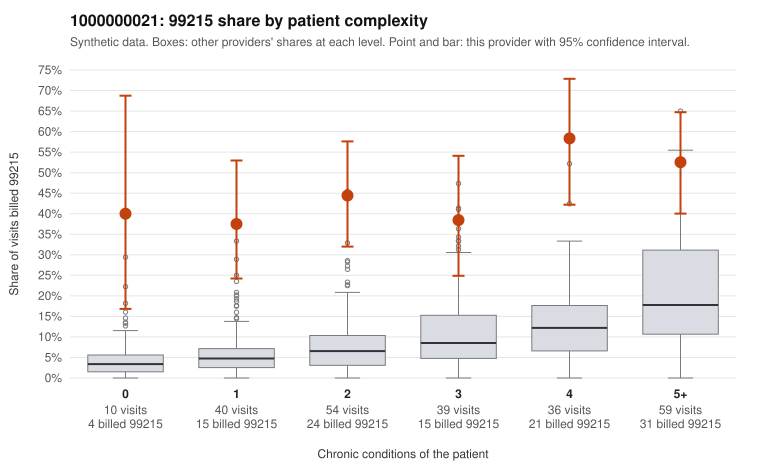

# 1000000021: 1000000021: 19 of 31 documented 99215 claims (61%) are documented below the billed level

**Leaning (advisory):** Pattern consistent with upcoding

## Why

1000000021 billed 99215 on 46.2% of 238 claims against an expected 9.3% given patient complexity (risk-adjusted score 7.01; plain z-score vs peers 6.18). 17% of this provider's 99215 claims were on patients with 0 or 1 chronic conditions. Records came back for 45 claims. Of 31 documented 99215 claims, 19 (61%) were documented below the billed level, against 32% for the comparison providers. Note checks on 45 returned notes (share showing each sign): problems 7%, late 16%, unsigned 0%, data 0%, bulk created 0%, paste heavy 0%. 1 of 35 notes claiming moderate-or-higher data reviewed had no lab or test line on the claim. This pattern is consistent with upcoding. It is a reason to review the records, not a finding. Examples: C0011713: billed 99215; documented MDM level moderate, 25 minutes. C0011770: billed 99215, patient aged 45 with 0 chronic condition(s); documented MDM level moderate, minutes not recorded. C0011832: billed 99215; documented MDM level moderate, 30 minutes. C0011735: billed 99215, patient aged 56 with 1 chronic condition(s) (COPD). C0011754: billed 99215, patient aged 71 with 1 chronic condition(s) (depression). C0011765: billed 99215, patient aged 47 with 1 chronic condition(s) (obesity).

## Evidence chart

## Cited claims

`C0011713`, `C0011770`, `C0011832`, `C0011735`, `C0011754`, `C0011765`

## Suggested next steps

- Request the full charts for C0011713, C0011770, C0011832 and have a certified coder re-score each against the current E/M rules (medical decision making or total time).
- If the re-scoring confirms the pattern, review the random sample in the recovery packet's sampling plan before any overpayment estimate; do not extrapolate from a targeted sample.
- Look at the notes themselves: 7% address fewer problems than their level implies and 16% were signed late; request the audit trail for C0011713, C0011770, C0011832.

---
Citations checked: 6/6 valid. Synthetic data. The leaning is advisory; the flag comes from the statistical screen, and no clinical documentation is available beyond the sampled records-review facts shown in the packet.
