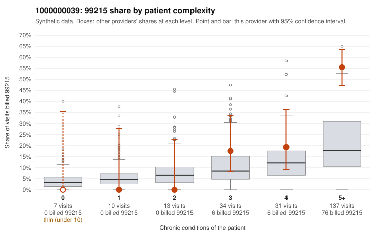

# 1000000039: Provider 1000000039's elevated 99215 rate sits almost entirely on patients with many chronic conditions, and the limited documentation largely supports the billed level, though some note-quality signals warrant a look.

**Leaning (advisory):** Pattern consistent with a high-acuity panel

## Why

1000000039 billed 99215 on 37.9% of 232 claims against an expected 13.6% given patient complexity (risk-adjusted score 3.73; plain z-score vs peers 4.85). 0% of this provider's 99215 claims were on patients with 0 or 1 chronic conditions. Records came back for 30 claims. Of 13 documented 99215 claims, 1 (8%) were documented below the billed level, against 32% for the comparison providers. Note checks on 30 returned notes (share showing each sign): problems 7%, late 3%, unsigned 0%, data 20%, bulk created 0%, paste heavy 3%. 7 of 27 notes claiming moderate-or-higher data reviewed had no lab or test line on the claim. The 99215 excess concentrates in the 5+ condition group, with none on low-complexity patients, and the sampled 99215 claims (e.g., C0022903, C0023024) involve multimorbid patients. Of the documented 99215 claims, only one (C0022860) fell below the billed level, far under the comparison rate, and several show high MDM (C0022955, C0023020, C0023024). This pattern is consistent with a genuinely complex panel rather than upcoding. Two caveats keep this from being clean. Records cover only 13 of 88 99215 claims. Even within the 5+ condition group, this provider's 99215 share still runs well above other providers, which risk adjustment may not fully explain. The note checks also flag notes claiming moderate-or-higher data review with no lab or test line on the claim, plus repeated times and duplicate text (e.g., C0022984, which is also paste-heavy). This is weak evidence that some notes may be templated to match the billed level, not proof. A reviewer should first compare C0022984, C0022860 and C0023004 against their claim lines for real data review. Next, request more 99215 charts from the 5+ condition group to confirm the high-MDM support holds beyond this small sample. Examples: C0022868: billed 99215; documented MDM level high, minutes not recorded. C0022955: billed 99215; documented MDM level high, 46 minutes. C0023020: billed 99215; documented MDM level high, 39 minutes. C0022869: billed 99215, patient aged 61 with 4 chronic condition(s) (hypothyroidism;hyperlipidemia;COPD;osteoarthritis). C0022903: billed 99215, patient aged 94 with 5 chronic condition(s) (hypothyroidism;hyperlipidemia;depression;atrial fibrillation;chronic kidney disease).

## Evidence chart

## Cited claims

`C0022868`, `C0022955`, `C0023020`, `C0022869`, `C0022903`

## Suggested next steps

- Do not pursue recovery on this evidence: 30 charts came back and they support the level billed (1 of 13 documented 99215 claims below the billed level).
- Revisit if the 99215 share keeps rising against peers or a larger sample shows unsupported claims.

---
Citations checked: 5/5 valid. Synthetic data. The leaning is advisory; the flag comes from the statistical screen, and no clinical documentation is available beyond the sampled records-review facts shown in the packet.
