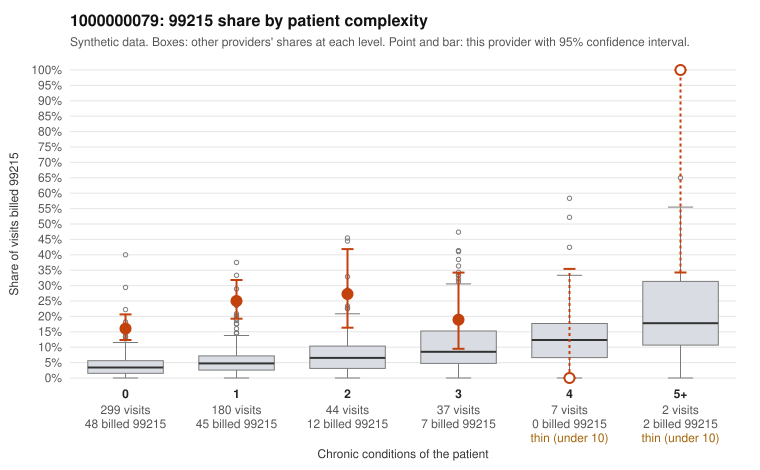

# 1000000079: 1000000079: 16 of 20 documented 99215 claims (80%) are documented below the billed level

**Leaning (advisory):** Pattern consistent with upcoding

## Why

1000000079 billed 99215 on 20.0% of 569 claims against an expected 4.0% given patient complexity (risk-adjusted score 6.89; plain z-score vs peers 1.99). 82% of this provider's 99215 claims were on patients with 0 or 1 chronic conditions. Records came back for 45 claims. Of 20 documented 99215 claims, 16 (80%) were documented below the billed level, against 32% for the comparison providers. Note checks on 45 returned notes (share showing each sign): problems 36%, late 2%, unsigned 0%, data 7%. No audit trail was received. 4 of 26 notes claiming moderate-or-higher data reviewed had no lab or test line on the claim. This pattern is consistent with upcoding. It is a reason to review the records, not a finding. Examples: C0042735: billed 99215, patient aged 47 with 0 chronic condition(s); documented MDM level moderate, 33 minutes. C0042749: billed 99215; documented MDM level moderate, 39 minutes. C0042990: billed 99215; documented MDM level moderate, 38 minutes. C0042549: billed 99215, patient aged 18 with 0 chronic condition(s). C0042557: billed 99215, patient aged 57 with 0 chronic condition(s). C0042561: billed 99215, patient aged 67 with 1 chronic condition(s) (chronic kidney disease).

## Evidence chart

## Cited claims

`C0042735`, `C0042749`, `C0042990`, `C0042549`, `C0042557`, `C0042561`

## Suggested next steps

- Request the full charts for C0042735, C0042749, C0042990 and have a certified coder re-score each against the current E/M rules (medical decision making or total time).
- If the re-scoring confirms the pattern, review the random sample in the recovery packet's sampling plan before any overpayment estimate; do not extrapolate from a targeted sample.
- Look at the notes themselves: 36% address fewer problems than their level implies and 2% were signed late; request the audit trail for C0042735, C0042749, C0042990.

---
Citations checked: 6/6 valid. Synthetic data. The leaning is advisory; the flag comes from the statistical screen, and no clinical documentation is available beyond the sampled records-review facts shown in the packet.
