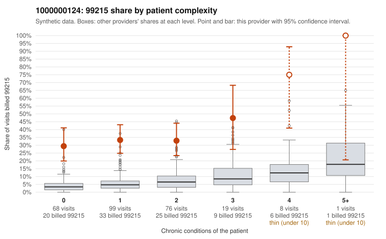

# 1000000124: 1000000124: too few returned records to judge

**Leaning (advisory):** Inconclusive

## Why

1000000124 billed 99215 on 34.7% of 271 claims against an expected 4.7% given patient complexity (risk-adjusted score 8.21; plain z-score vs peers 4.33). 56% of this provider's 99215 claims were on patients with 0 or 1 chronic conditions. Records came back for 45 claims. Of 24 documented 99215 claims, 5 (21%) were documented below the billed level, against 32% for the comparison providers. Note checks on 45 returned notes (share showing each sign): problems 31%, late 9%, unsigned 0%, data 4%, bulk created 0%, paste heavy 2%. 3 of 39 notes claiming moderate-or-higher data reviewed had no lab or test line on the claim. The evidence does not support a call either way yet. Examples: C0060149: billed 99215; documented MDM level moderate, minutes not recorded. C0060180: billed 99215; documented MDM level low, minutes not recorded. C0060070: billed 99215, patient aged 32 with 1 chronic condition(s) (osteoarthritis). C0060078: billed 99215, patient aged 55 with 1 chronic condition(s) (hyperlipidemia).

## Evidence chart

## Cited claims

`C0060149`, `C0060180`, `C0060070`, `C0060078`

## Suggested next steps

- 45 charts came back but do not settle it: request a targeted sample of 99215 charts, starting with C0060149, C0060180, C0060070.
- Re-check after the targeted charts arrive; do not call upcoding or a sicker panel on this evidence alone.

---
Citations checked: 4/4 valid. Synthetic data. The leaning is advisory; the flag comes from the statistical screen, and no clinical documentation is available beyond the sampled records-review facts shown in the packet.
