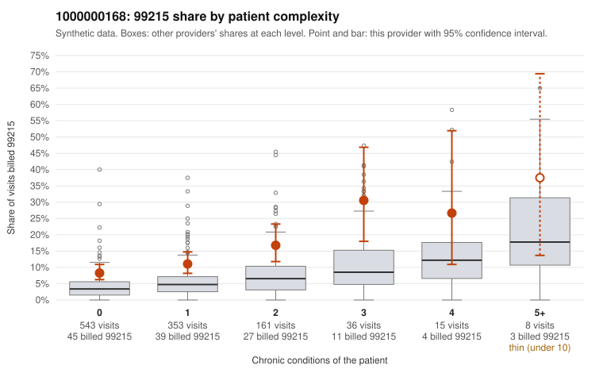

# 1000000168: 1000000168: 11 of 18 documented 99215 claims (61%) are documented below the billed level

**Leaning (advisory):** Pattern consistent with upcoding

## Why

1000000168 billed 99215 on 11.6% of 1,116 claims against an expected 4.1% given patient complexity (risk-adjusted score 4.37; plain z-score vs peers 0.63). 65% of this provider's 99215 claims were on patients with 0 or 1 chronic conditions. Records came back for 45 claims. Of 18 documented 99215 claims, 11 (61%) were documented below the billed level, against 32% for the comparison providers. Note checks on 45 returned notes (share showing each sign): problems 24%, late 4%, unsigned 0%, data 0%. No audit trail was received. 2 of 24 notes claiming moderate-or-higher data reviewed had no lab or test line on the claim. This pattern is consistent with upcoding. It is a reason to review the records, not a finding. Examples: C0080727: billed 99215; documented MDM level moderate, 32 minutes. C0081124: billed 99215; documented MDM level moderate, minutes not recorded. C0081537: billed 99215; documented MDM level moderate, 20 minutes. C0080772: billed 99215, patient aged 55 with 0 chronic condition(s). C0080774: billed 99215, patient aged 18 with 1 chronic condition(s) (chronic kidney disease). C0080880: billed 99215, patient aged 35 with 0 chronic condition(s).

## Evidence chart

## Cited claims

`C0080727`, `C0081124`, `C0081537`, `C0080772`, `C0080774`, `C0080880`

## Suggested next steps

- Request the full charts for C0080727, C0081124, C0081537 and have a certified coder re-score each against the current E/M rules (medical decision making or total time).
- If the re-scoring confirms the pattern, review the random sample in the recovery packet's sampling plan before any overpayment estimate; do not extrapolate from a targeted sample.
- Look at the notes themselves: 24% address fewer problems than their level implies and 4% were signed late; request the audit trail for C0080727, C0081124, C0081537.

---
Citations checked: 6/6 valid. Synthetic data. The leaning is advisory; the flag comes from the statistical screen, and no clinical documentation is available beyond the sampled records-review facts shown in the packet.
