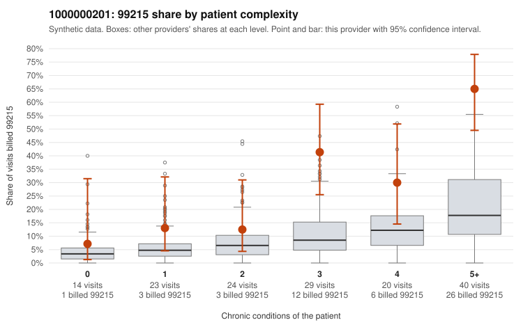

# 1000000201: 1000000201: too few returned records to judge

**Leaning (advisory):** Inconclusive

## Why

1000000201 billed 99215 on 34.0% of 150 claims against an expected 9.4% given patient complexity (risk-adjusted score 3.58; plain z-score vs peers 4.22). 8% of this provider's 99215 claims were on patients with 0 or 1 chronic conditions. Records came back for 24 claims. Of 7 documented 99215 claims, 1 (14%) were documented below the billed level, against 32% for the comparison providers. Note checks on 24 returned notes (share showing each sign): problems 4%, late 4%, unsigned 0%, data 8%. No audit trail was received. 3 of 16 notes claiming moderate-or-higher data reviewed had no lab or test line on the claim. The evidence does not support a call either way yet. Examples: C0092198: billed 99215; documented MDM level moderate, minutes not recorded. C0092188: billed 99215, patient aged 49 with 1 chronic condition(s) (hyperlipidemia). C0092245: billed 99215, patient aged 28 with 0 chronic condition(s).

## Evidence chart

## Cited claims

`C0092198`, `C0092188`, `C0092245`

## Suggested next steps

- 24 charts came back but do not settle it: request a targeted sample of 99215 charts, starting with C0092198, C0092188, C0092245.
- Re-check after the targeted charts arrive; do not call upcoding or a sicker panel on this evidence alone.

---
Citations checked: 3/3 valid. Synthetic data. The leaning is advisory; the flag comes from the statistical screen, and no clinical documentation is available beyond the sampled records-review facts shown in the packet.
