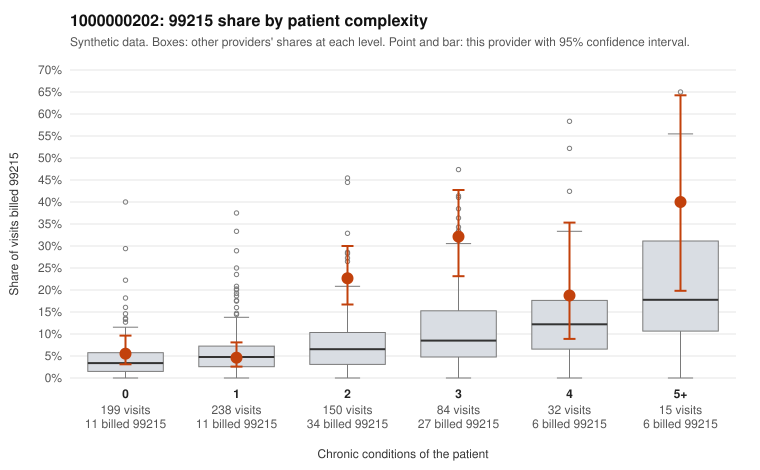

# 1000000202: 1000000202: documented 99215 claims mostly support the level billed (0% below)

**Leaning (advisory):** Pattern consistent with a high-acuity panel

## Why

1000000202 billed 99215 on 13.2% of 718 claims against an expected 5.1% given patient complexity (risk-adjusted score 3.40; plain z-score vs peers 0.90). 23% of this provider's 99215 claims were on patients with 0 or 1 chronic conditions. Records came back for 29 claims. Of 7 documented 99215 claims, 0 (0%) were documented below the billed level, against 32% for the comparison providers. Note checks on 29 returned notes (share showing each sign): problems 24%, late 3%, unsigned 0%, data 0%. No audit trail was received. 0 of 19 notes claiming moderate-or-higher data reviewed had no lab or test line on the claim. This pattern is consistent with a high-acuity panel. The sampled documentation supports the billed level. Examples: C0092368: billed 99215, patient aged 52 with 1 chronic condition(s) (type 2 diabetes); documented MDM level high, 48 minutes. C0092664: billed 99215; documented MDM level high, 54 minutes. C0092764: billed 99215; documented MDM level high, 45 minutes. C0092474: billed 99215, patient aged 96 with 5 chronic condition(s) (obesity;hyperlipidemia;hypertension;atrial fibrillation;COPD). C0092533: billed 99215, patient aged 87 with 4 chronic condition(s) (type 2 diabetes;obesity;COPD;asthma).

## Evidence chart

## Cited claims

`C0092368`, `C0092664`, `C0092764`, `C0092474`, `C0092533`

## Suggested next steps

- Do not pursue recovery on this evidence: 29 charts came back and they support the level billed (0 of 7 documented 99215 claims below the billed level).
- Revisit if the 99215 share keeps rising against peers or a larger sample shows unsupported claims.

---
Citations checked: 5/5 valid. Synthetic data. The leaning is advisory; the flag comes from the statistical screen, and no clinical documentation is available beyond the sampled records-review facts shown in the packet.
