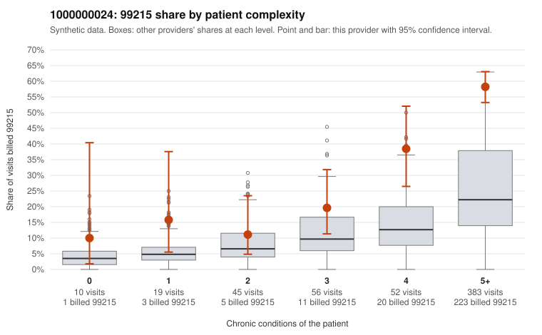

# 1000000024: 1000000024: too few returned records to judge

**Leaning (advisory):** Inconclusive

## Why

1000000024 billed 99215 on 46.5% of 565 claims against an expected 15.2% given patient complexity (risk-adjusted score 7.55; plain z-score vs peers 6.38). 2% of this provider's 99215 claims were on patients with 0 or 1 chronic conditions. Records came back for 24 claims. Of 17 documented 99215 claims, 4 (24%) were documented below the billed level, against 28% for the comparison providers. Note checks on 24 returned notes (share showing each sign): problems 0%, late 0%, unsigned 0%, data 0%. No audit trail was received. 1 of 22 notes claiming moderate-or-higher data reviewed had no lab or test line on the claim. The evidence does not support a call either way yet. Examples: C0015323: billed 99215; documented MDM level moderate, minutes not recorded. C0015413: billed 99215; documented MDM level moderate, 39 minutes. C0015222: billed 99215, patient aged 44 with 0 chronic condition(s). C0015371: billed 99215, patient aged 30 with 1 chronic condition(s) (asthma).

## Evidence chart

## Cited claims

`C0015323`, `C0015413`, `C0015222`, `C0015371`

## Suggested next steps

- 24 charts came back but do not settle it: request a targeted sample of 99215 charts, starting with C0015323, C0015413, C0015222.
- Re-check after the targeted charts arrive; do not call upcoding or a sicker panel on this evidence alone.

---
Citations checked: 4/4 valid. Synthetic data. The leaning is advisory; the flag comes from the statistical screen, and no clinical documentation is available beyond the sampled records-review facts shown in the packet.
